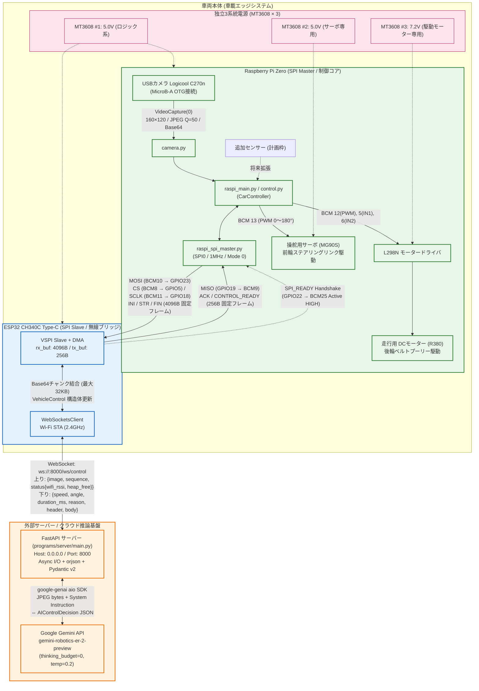
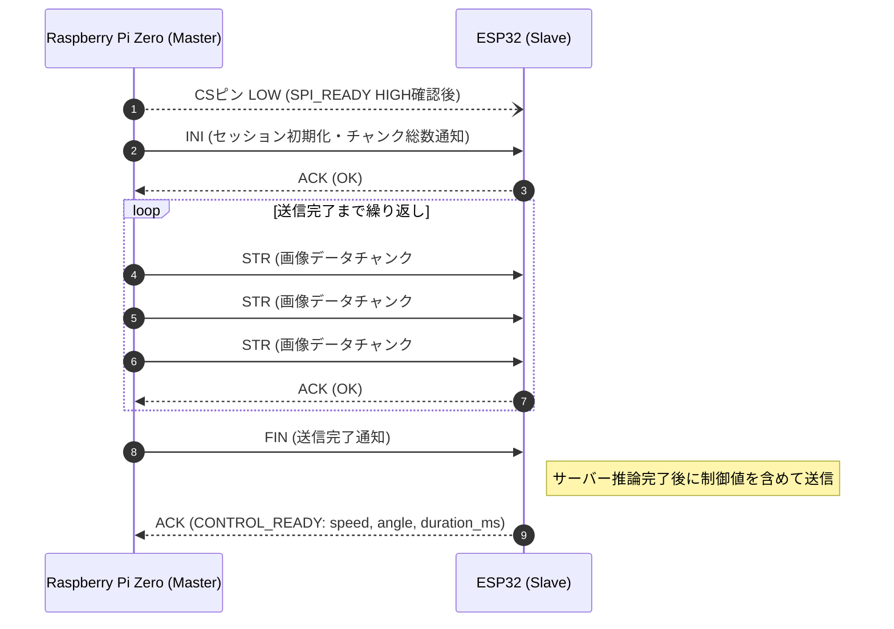
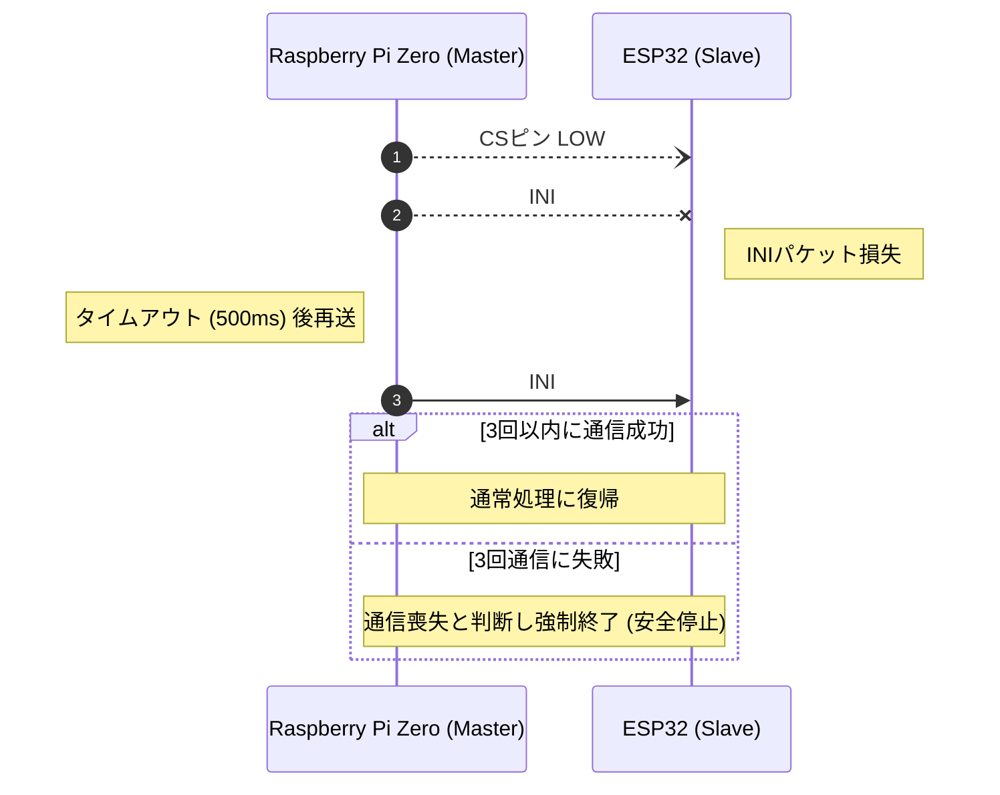
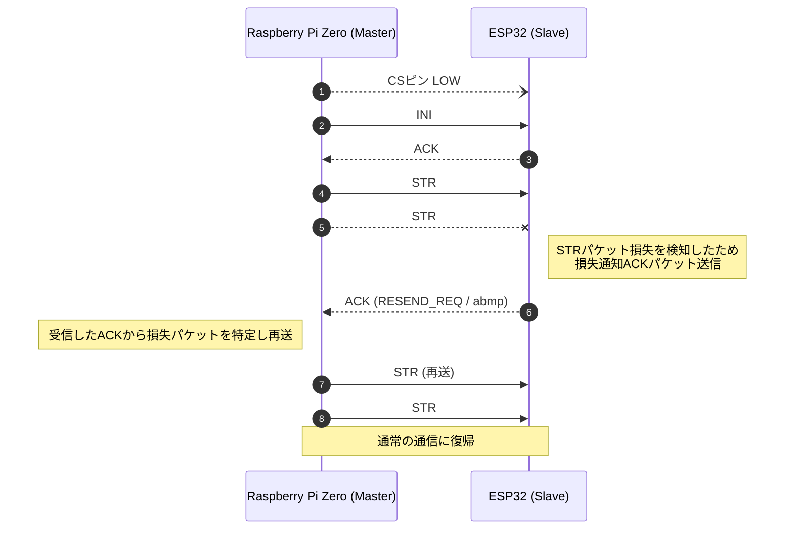
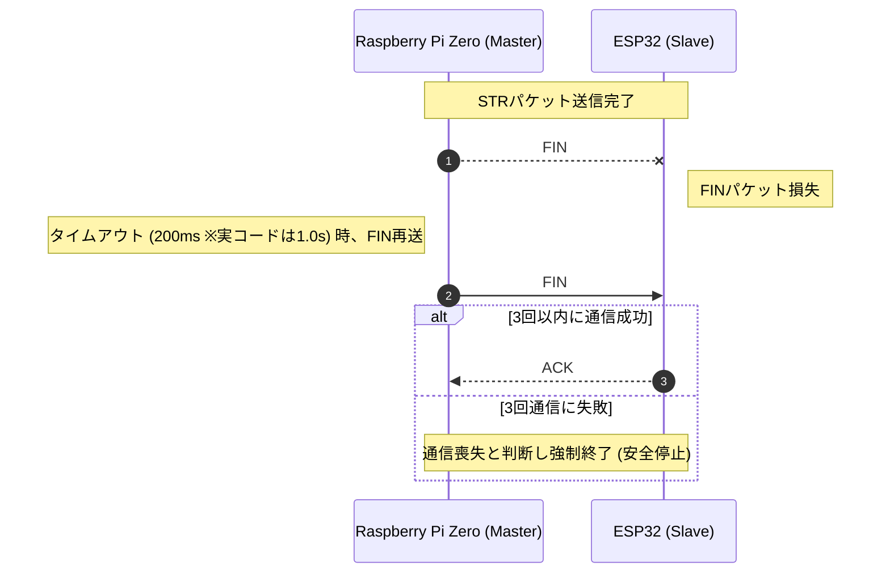
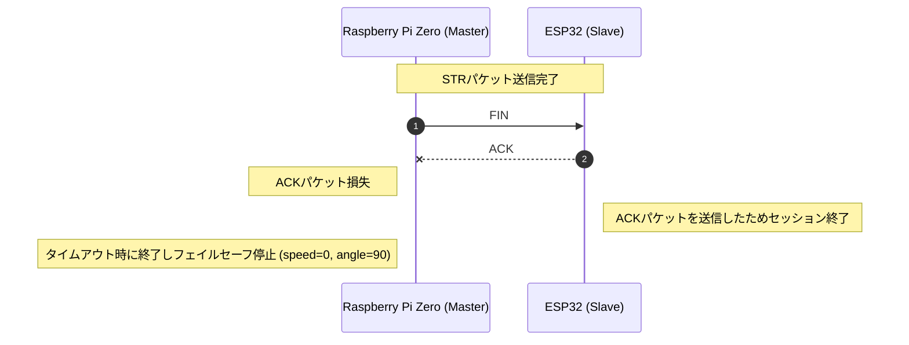
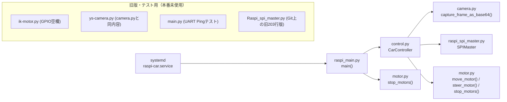
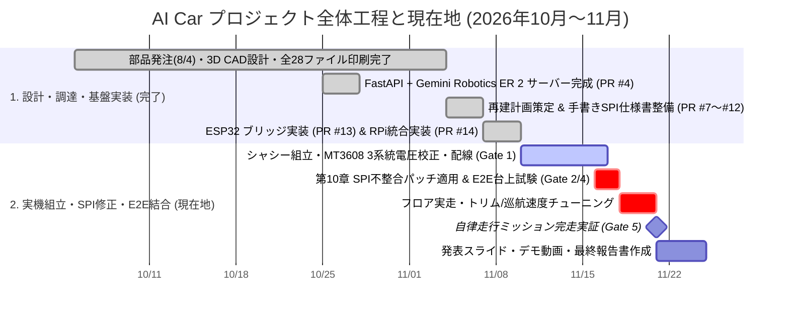

# 🚗 AI Car Autonomous Driving Project (`ai-car`) 完全統合技術ドキュメント

> **対象ディレクトリ:** `E:\documents\programs\ai-car`  
> **GitHub リポジトリ:** `https://github.com/Hita-haru/ai-car` (`main` ブランチ)  
> **プロジェクト正式名称:** 画像解析技術および視覚言語モデル (VLM) を用いた自律走行車両の開発  
> **中核技術スタック:** Google `gemini-robotics-er-2-preview` + FastAPI (Async WebSocket) + ESP32 CH340C (SPI Slave / Wi-Fi Bridge) + Raspberry Pi Zero (SPI Master / Camera & Actuator Control)  
> **最終解析・更新日:** 2026年11月16日

本ドキュメントは、`ai-car` ディレクトリ内に存在する **全ソースコード・設定ファイル・既存設計書・手書きプロトコル仕様画像 (`scanned-docs/`)・3D CAD/メッシュデータ (`3d/` 全28ファイル)・部品表および購入領収書 (`BOM.csv`, `requested-BOM.xlsx`, `receipt/`)・Gitコミット履歴** をすべて精査し、**他のファイルを一切開かなくても、このドキュメント1冊だけでプロジェクトの全容から関数・バイト単位の実装仕様、未解決バグの修正コード、実機運用・トラブルシューティングまで完全に理解できるレベル** で体系化した完全リファレンスです。

---

## 📌 3分でわかるプロジェクト要約（エグゼクティブ・サマリー）

| 項目 | 仕様・内容 |
|---|---|
| **開発目的** | 車載USBカメラの前方映像から、ロボティクス特化VLM（**Gemini Robotics ER 2 preview**）が障害物・自由空間を空間推論し、リアルタイムに操舵角・速度を決定して自律走行する小型車両を開発する。 |
| **なぜ2マイコン構成か** | 車載メインの **Raspberry Pi Zero（無印）** には Wi-Fi が搭載されていないため、カメラ取得とモーター/サーボ駆動を **RPi Zero (SPI Master)** が担い、Wi-Fi / WebSocket 通信を **ESP32 (SPI Slave)** が担う分散エッジ構成を採用している。 |
| **車体・機構 (`3d/`)** | 前後分割シャシー（前 `332.0×102.5×120.0 mm` / 後 `302.0×102.5×120.0 mm`）＋3Dプリント製ベアリング（`φ32`, `φ30`, `φ22`）・シャフト・ベルトプーリー（`φ20`）・タイヤ（`φ50×20`）・ステアリングリンク（全28ファイル出力済み）。 |
| **電装・電源系** | **MT3608 昇圧コンバータ×3基** で ①ロジック系 `5.0V`、②サーボ系 `5.0V`、③DCモーター系 `7.2V` を完全分離し、モーター逆起電力やサーボ突入電流によるマイコンリセット（ブラウンアウト）を防止。 |
| **エッジ間通信 (SPI)** | RPi Zero (`SPI0`, `1 MHz`, Mode 0) ⇔ ESP32 (`VSPI` + DMA) 間で独自JSONプロトコル（`INI` / `STR` / `FIN` / `ACK`）＋物理ハンドシェイク線 `SPI_READY` (`ESP32 GPIO22 → RPi BCM25`) による双方向通信を実行。 |
| **クラウド推論通信** | ESP32 ⇔ FastAPI (`ws://<IP>:8000/ws/control`) 間で Base64 JPEG画像（`160×120`, 品質`50`, 約3〜5KB）を送受信。`thinking_budget=0` により約 `300〜450 ms` で `speed` (`-255〜255`)・`angle` (`0〜180°`)・`reason` を構造化JSON出力。 |
| **駆動制御方式** | 1サイクルごとに指定時間（標準 `500 ms`）だけモーターを駆動した後に一旦 `stop_motors()` で停止する **パルス間欠走行方式** を採用（推論遅延中の暴走防止＋次フレーム撮影時の手ブレ防止）。 |
| **調達コスト** | AliExpress 電子部品5点：`BOM.csv` 記載 **¥2,767**（領収書実決済額合計 **¥2,810**） ／ 学校申請・立替精算リスト8点：Excel表記載 **¥21,300**（実計算合計 **¥23,300**）。 |
| **現在の到達度と課題** | サーバー・ESP32・RPi Zero の全コードは一通り実装完了（PR #4, #13, #14）。ただし **RPi ⇔ ESP32 間のSPI JSONキー名不一致・256Bダミー読出し時のエラー上書き・FIN応答の1サイクル遅延** の3点がコード突合で判明しており、実機結合前に第10章の修正適用が必須。 |

---

## 📑 目次

1. [プロジェクト概要・システムアーキテクチャ・開発履歴](#1-プロジェクト概要システムアーキテクチャ開発履歴)
   - 1.1 背景と設計思想 / 1.2 全体システムアーキテクチャ図 / 1.3 1制御サイクルのE2Eデータフローと遅延バジェット / 1.4 リポジトリの開発変遷史（Gitコミット全履歴）
2. [ディレクトリ構造と全ファイル完全カタログ](#2-ディレクトリ構造と全ファイル完全カタログ)
   - 2.1 ディレクトリツリー / 2.2 ルート・管理・ドキュメント・画像ファイル一覧 / 2.3 プログラム・設定ファイル全一覧 / 2.4 Gitインデックスとローカル作業ツリーの差異
3. [機械設計・3D CADモデル (`3d/`) & 部品調達・領収書照合 (`BOM` / `receipt/`)](#3-機械設計3d-cadモデル-3d--部品調達領収書照合-bom--receipt)
   - 3.1 車両機構の全体構成と動力伝達図 / 3.2 `3d/` 全28ファイル実寸・メッシュ仕様一覧 / 3.3 `BOM.csv` と領収書画像5枚の完全照合 / 3.4 追加申請リスト (`requested-BOM.xlsx`) と集計差異
4. [電装・電源設計とGPIOピンアサイン仕様](#4-電装電源設計とgpioピンアサイン仕様)
   - 4.1 MT3608×3系統 電源分離回路図 / 4.2 Raspberry Pi Zero 40ピン物理ヘッダ配置図 / 4.3 全信号ピンアサイン完全対応表 / 4.4 電源・電気設計上の重要な注意事項
5. [通信プロトコル完全仕様 (SPI Master-Slave & WebSocket)](#5-通信プロトコル完全仕様-spi-master-slave--websocket)
   - 5.1 プロトコル全体階層構造 / 5.2 `SPI_READY` 物理ハンドシェイクとS→M通信成立4要件 / 5.3 正常系・異常系4パターンの全シーケンス図 (`MSprotocol.md`) / 5.4 手書きパケット仕様書 (`scanned-docs/*.PNG`) 完全文字起こし＆計算詳解 / 5.5 手書き仕様 vs RPi実装 vs ESP32実装 3者比較表 / 5.6 WebSocket・HTTP パケット仕様
6. [ソフトウェア詳細リファレンス①：Raspberry Pi Zero (`programs/raspberry-pi-zero/`)](#6-ソフトウェア詳細リファレンス①raspberry-pi-zero-programsraspberry-pi-zero)
   - 6.1 モジュール呼び出し階層図 / 6.2 `raspi_main.py` / 6.3 `control.py` / 6.4 `raspi_spi_master.py` & 旧大文字版との比較 / 6.5 `motor.py` & `ik-motor.py` / 6.6 `camera.py` & `ys-camera.py` / 6.7 `main.py` (旧UART) / 6.8 `systemd` 自動起動手順
7. [ソフトウェア詳細リファレンス②：ESP32 (`programs/esp32/esp32.ino`)](#7-ソフトウェア詳細リファレンス②esp32-programsesp32esp32ino)
   - 7.1 記述規約・ヘッダ・定数・DMAバッファ / 7.2 状態構造体 (`VehicleControl`) とグローバル変数 / 7.3 全関数リファレンス / 7.4 SPI・WebSocket内部状態遷移の詳細
8. [ソフトウェア詳細リファレンス③：FastAPI & Gemini AI サーバー (`programs/server/`)](#8-ソフトウェア詳細リファレンス③fastapi--gemini-ai-サーバー-programsserver)
   - 8.1 依存パッケージ (`requirements.txt`) / 8.2 環境変数・設定クラス (`ControlConfig`, `AIConfig`) / 8.3 データモデルと入出力ヘルパー関数 / 8.4 Gemini システムプロンプト全文と推論パイプライン / 8.5 全API・WebSocketエンドポイント仕様
9. [既存ドキュメント横断ガイド（どの資料が最新で、どこが古いか）](#9-既存ドキュメント横断ガイドどの資料が最新でどこが古いか)
10. [【最重要】コード解析で判明した不整合・バグと具体的修正パッチ](#10-最重要コード解析で判明した不整合バグと具体的修正パッチ)
    - 10.1 課題・修正優先度サマリー / 10.2 [P0-1] SPI JSONキー名とチェックサム計算不一致 / 10.3 [P0-2] 256Bダミー読出しによる `EmptyInput` エラー上書き＆STR ACK整合 / 10.4 [P0-3] `FIN` 後の推論待ち競合（1サイクル遅れの古い制御値問題）と一括修正パッチ / 10.5 [P1/P2] Git大文字小文字衝突・サーボPWM微振動対策
11. [環境構築・ビルド・起動・テスト完全手順書 & トラブルシューティング](#11-環境構築ビルド起動テスト完全手順書--トラブルシューティング)
    - 11.1 Step 1: サーバー構築 / 11.2 Step 2: ESP32書き込み / 11.3 Step 3: RPi Zero構築と段階テスト / 11.4 実機トラブルシューティング早見表
12. [プロジェクト管理・WBS進捗・リスク管理・多層フォールバック戦略](#12-プロジェクト管理wbs進捗リスク管理多層フォールバック戦略)
    - 12.1 工程ガントチャート / 12.2 段階的検証ゲート (Quality Gates) / 12.3 WBS全項目チェックリスト（2026/11/16実績反映） / 12.4 リスク管理マトリクス / 12.5 Plan A / B / C 多層フォールバック戦略

---

## 1. プロジェクト概要・システムアーキテクチャ・開発履歴

### 1.1 背景と設計思想
本プロジェクトは、課題研究として取り組まれている **「最新の視覚言語モデル（VLM）を用いた自律走行車両」** のフルスクラッチ開発プロジェクトです。従来のライントレース車（赤外線反射センサーや単純な色閾値フィルタ）とは異なり、車載カメラが捉えた生の前方風景を **Google Gemini Robotics ER 2 preview** に直接入力し、身体化空間推論（Embodied Spatial Reasoning）によって「どこに障害物があり、どちらへ舵を切れば安全に走行できるか」を自然言語の根拠（`reason`）付きで判断させます。

設計上の最大の工夫は以下の3点です。
1. **Wi-Fi非搭載の Raspberry Pi Zero を活かす Master-Slave 分業構成**  
   手持ち機材の Raspberry Pi Zero（無印）は無線機能を持たないため、Wi-Fi内蔵マイコン **ESP32 CH340C** を通信コプロセッサ（SPI Slave ↔ WebSocket ブリッジ）として組み合わせ、RPi Zero 側は画像キャプチャとGPIO駆動に専念させています。
2. **500ms サイクルを目指した徹底的な低遅延設計**  
   - 画像を `160×120` 解像度・JPEG品質 `50` に圧縮し、Base64文字列長を約 `3,500〜6,800 文字`（約 `2.5〜5.0 KB`）に軽量化。
   - サーバー側は完全非同期 (`asyncio` + `google-genai` aio SDK + C言語実装 `orjson`) で構築し、Geminiの思考トークンを `thinking_budget=0` でスキップして推論時間を `300〜450 ms` 台に短縮。
3. **多重フェイルセーフとパルス間欠駆動**  
   - サーバー未接続・APIキー未設定・JSON破損・SPIタイムアウトのいずれが発生しても、全階層で即座に **`speed = 0`（停止）, `angle = 90`（直進中立）** にフォールバックする安全設計を徹底。
   - 1回の推論ごとに `duration_ms`（標準 `500 ms`）走行して一旦停止する間欠制御により、通信遅延中の衝突や次フレーム撮影時のモーションブラーを防いでいます。

---

### 1.2 全体システムアーキテクチャ図



---

### 1.3 1制御サイクルのE2Eデータフローと遅延バジェット

車載カメラのシャッターからタイヤが回転・停止するまでの1ループ（8ステップ）のデータの流れとデータ量・想定処理時間は以下の通りです。

| Step | フェーズ | 実行箇所 | データの形態・サイズ | 想定時間 |
|:---:|---|---|---|:---:|
| **1** | **前方映像の撮影・軽量化** | RPi `camera.py`<br>`capture_frame_as_base64()` | USBカメラ生フレーム（例: `640×480` BGR）→ `160×120` リサイズ → JPEG品質 `50` 圧縮（約 `2.5〜4.0 KB`）→ Base64文字列（約 `3,500〜5,500 chars`） | `20〜35 ms` |
| **2** | **チャンク分割** | RPi `control.py`<br>`split_image_data()` | `STR_CHUNK_SIZE = 2048` 文字単位で分割（通常 **2〜3チャンク**） | `< 1 ms` |
| **3** | **SPI セッション開始 (`INI`)** | RPi `raspi_spi_master.py`<br>⇔ ESP32 `esp32.ino` | `SPI_READY` HIGH確認 → `4096 B`（JSON＋`\0`パディング）を `1 MHz` で送信（物理転送 `32.8 ms`）→ `256 B` の `OK` ACK受信（物理転送 `2.0 ms`） | `35〜45 ms` |
| **4** | **SPI 画像チャンク転送 (`STR`)** | RPi `raspi_spi_master.py`<br>⇔ ESP32 `esp32.ino` | `4096 B` フレーム × チャンク数（2〜3回）をMOSIで送信し、ESP32が `g_assembled_image` に文字列結合 → ACK確認 | `70〜110 ms` |
| **5** | **SPI 完了通知 (`FIN`) & WS送信** | RPi `send_fin()`<br>→ ESP32 `send_assembled_image_to_server()` | `4096 B` の `FIN` 送信 → ESP32が `{"image":"...","sequence":N,"status":{"wifi_rssi":...,"heap_free":...}}` を WebSocket テキストフレームで送信 | `40〜60 ms` |
| **6** | **Gemini 空間推論** | Server `main.py`<br>⇔ Google Gemini API | Base64デコード → `types.Part.from_bytes(mime_type="image/jpeg")` で `gemini-robotics-er-2-preview` へ非同期送信 → `AIControlDecision(speed, angle, reason)` 取得 | `300〜450 ms` |
| **7** | **制御値返信 (WS → SPI)** | Server → ESP32 → RPi | WebSocketで制御JSON受信 → ESP32 `g_control` 更新 → `tx_buf` (`256 B`) に `CONTROL_READY` パケット格納 → RPiがダミークロック `[0x00]*256` で読出し | `10〜20 ms` |
| **8** | **サーボ操舵・DCモーター駆動** | RPi `control.py`<br>→ `motor.py` | `steer_motor(angle)` で前輪転舵 → `move_motor(speed)` で駆動 → `time.sleep(duration_ms / 1000)`（標準 `500 ms`）走行 → `stop_motors()` で停止・中立復帰 | `500 ms`（走行時間） |

> [!NOTE]
> **サイクルタイム合計:** 通信・推論オーバーヘッドが **約 `480〜720 ms`**、実走行時間が **`500 ms`** のため、車両は **約 `1.0〜1.2 秒` に1回のペースで「静止状態でクリアな前方撮影 → 空間推論 → 0.5秒前進/転舵 → 停止」** を繰り返します。

---

### 1.4 リポジトリの開発変遷史（Gitコミット全履歴解析）

`git log --all` およびブランチ一覧から復元した本プロジェクトの時系列進化は以下の通りです。どのファイルがいつ作られ、なぜ旧ファイルや仕様差分が存在するのかがこの表から一目でわかります。

| 日時 (JST) | コミット / PR | 作成者 | 主な変更内容とプロジェクト上の意味 |
|---|---|---|---|
| `2026-10-05 08:24` | `78499fb` | Haruki | **初期コミット:** `3d/` 全28ファイル、`BOM.csv`、`receipt/receipt1〜5.png`、`MSprotocol.md`、`data-flowchart.md`、および初期骨格コード（`esp32.ino` 77行、`ik-motor.py`、`ys-camera.py`、`raspberry-pi-zero/main.py`、`server/main.py` 16行）を一括登録。 |
| `2026-10-05 08:25` | `9f73fa3` | Haruki | `README.md`（68行）を追加。 |
| `2026-10-05 09:54〜09:55` | `a8cd38b`, `415bc9f`, `3abcdbe` | Hita-haru | 初期コードの構文エラー群（`server/main.py` の `BaseModel` import漏れ、`ik-motor.py` ピン構文、`main.py` Pingループ、`esp32.ino` の `SPI_CHUNKSIZE` タイポ・プロトタイプ切れ・未宣言 `doc` 参照）を応急修正。 |
| `2026-10-06 14:40` | `5858da1` | Hita-haru | `README.md` のモデル表記等を `Gemini Robotics ER 2 preview` に更新。 |
| `2026-10-27 15:52` | `bb9f8b1` / **PR #4** (`feautures/add-server-programs`) | Hita-haru / Satmo | **サーバー完成:** `programs/server/main.py` を16行のスタブから **511行の完全非同期 FastAPI + Gemini Robotics ER 2 サーバー** に全面刷新。`.env.example`, `server/README.md`, `requirements.txt`, `requested-BOM.xlsx` を追加。 |
| `2026-11-04 16:24` | `e89800d` / **PR #5** (`docs/mid-plan`) | Hita-haru / Satmo | 課題研究の進捗整理メモ `中間計画1.md`（52行）と `中間計画1_続き.md`（68行）を追加（※後にローカル作業ツリーで1つの `中間計画1.md` 統合版へマージ）。 |
| `2026-11-04 19:00`〜`11-05 17:24` | `5e0f6cd`〜`7dd789e` / **PR #7, #8, #9** (`docs/summary` 他) | Hita-haru / Satmo | 遅延リカバリーのための総合仕様・WBS・フォールバック計画書 **`ai-car-summary.md`** を策定し、ガントチャートや双方向SPI仕様を大幅拡充。 |
| `2026-11-05 19:00〜19:20` | `cae138a`, `c2279ba` / **PR #11** (`fix/scanned-docs`) | Hita-haru / Satmo | 手書きSPIパケット仕様書 **`scanned-docs/{INI,STR,FIN,ACK}_packet.PNG`** を追加・画像サイズ最適化（計255MB→18MB）。同時に初期試作版 **`Raspi_spi_master.py`（先頭大文字・203行）** と `ai-car-summary.pdf` を追加。 |
| `2026-11-06 16:43` | `ede8d95` / **PR #12** (`fix/ai-car-summary.md`) | Hita-haru / Satmo | `ai-car-summary.md` のGPIOピンアサイン表・`SPI_READY` ハンドシェイク仕様を更新し、`MSprotocol.pdf` を追加。 |
| `2026-11-09 10:37` | `4ea42d9` / **PR #13** (`features/esp32-program`) | Hita-haru / Satmo | **ESP32完成:** `programs/esp32/esp32.ino` を **517行の SPI Slave (VSPI+DMA) ↔ WebSocket ブリッジ完全版** に全面実装。 |
| `2026-11-09 10:49` | `b33bec8` / **PR #14** (`features/raspi-program`) | justaman & zanzouda / Hita-haru / Satmo | **RPi Zero完成:** `raspi_main.py`, `control.py`, **`raspi_spi_master.py`（先頭小文字・376行）**, `motor.py`（GPIO確定版）, `camera.py`, `ラズパイのOS起動後に自動でプログラムを動作させるための方法.txt` を一括追加。 |

---

## 2. ディレクトリ構造と全ファイル完全カタログ

### 2.1 ディレクトリツリー（全ファイル網羅）

```text
E:\documents\programs\ai-car\
├── .git/                                # Gitリポジトリ管理情報 (origin: github.com/Hita-haru/ai-car)
│
├── AI-CAR_完全ドキュメント.md            # ★ 本ドキュメント（ディレクトリ全容の完全統合技術仕様書）
├── README.md                            # リポジトリトップページ（概要・簡易構成図）
├── ai-car-summary.md                    # 2026/11/05〜06策定 総合マスター仕様・遅延リカバリー再建計画書
├── ai-car-summary.pdf                   # ai-car-summary.md のPDF出力版
├── MSprotocol.md                        # Master-Slave SPI通信プロトコル シーケンス図・障害復旧仕様
├── MSprotocol.pdf                       # MSprotocol.md のPDF出力版（全4ページ）
├── data-flowchart.md                    # システム全体のデータフロー図（Mermaid原図）
├── 中間計画1.md                          # 課題研究 中間計画1（統合版：進捗と初期バグ洗い出し記録）
│
├── BOM.csv                              # 購入済み電子部品リスト（AliExpress 5品目・計¥2,767）
├── requested-BOM.xlsx                   # 学校予算申請・個人立替精算用リスト（8品目・表記載¥21,300）
│
├── receipt/                             # AliExpress 注文領収書スクリーンショット（2026/08/04注文分）
│   ├── receipt1.png                     #   R380 高速DCモーター（¥465）
│   ├── receipt2.png                     #   MT3608 DC-DC昇圧コンバータ 3個セット（¥472）
│   ├── receipt3.png                     #   ESP32 CH340C Type-C 開発ボード（¥814）
│   ├── receipt4.png                     #   L298N モータードライバボード（¥643）
│   └── receipt5.png                     #   MG90S 金属ギアマイクロサーボ 180°（¥416）
│
├── scanned-docs/                        # 手書きSPIパケットJSON仕様書スキャン画像（全4枚）
│   ├── INI_packet.PNG                   #   INI（セッション初期化）パケット仕様と共通備考ルール
│   ├── STR_packet.PNG                   #   STR（データストリーム転送）パケット仕様とXOR計算定義
│   ├── FIN_packet.PNG                   #   FIN（転送終了）パケット仕様
│   └── ACK_packet.PNG                   #   ACK（確認応答・選択的再送ビットマップ abmp）仕様と計算例
│
├── 3d/                                  # 車体3D CADデータ (.FCStd/.step) & 印刷用メッシュ (.3mf/.stl) 全28ファイル
│   ├── シャーシ前.step                   #   前部メインシャシー (STEP, 332.0 × 102.5 × 120.0 mm)
│   ├── シャーシ後ろ.step                 #   後部メインシャシー (STEP, 302.0 × 102.5 × 120.0 mm)
│   ├── 締結部品.FCStd / .3mf            #   前後シャシー連結ブラケット (15.0 × 17.32 × 5.0 mm)
│   ├── サーボモーター固定治具.FCStd / .3mf #   MG90S サーボ固定マウント (33.0 × 92.5 × 8.0 mm)
│   ├── 前輪駆動部品.FCStd / .3mf / .stl / .20260731-141154.FCBak  # 前輪ステアリングリンク1
│   ├── 前輪駆動部品2.FCStd / .3mf        #   前輪ステアリングリンク2 (142.5 × 25.0 × 5.0 mm)
│   ├── 前輪シャフト.FCStd / .3mf         #   前輪用車軸シャフト (φ8.0 × 25.0 mm)
│   ├── 前輪プーリー.FCStd / .3mf         #   前輪側プーリー (φ20.0 × 3.5 mm)
│   ├── 後輪シャフト.FCStd / .stl         #   後輪用ロング車軸シャフト (φ8.0 × 154.0 mm)
│   ├── 後輪プーリー.FCStd / .3mf         #   後輪駆動ベルトプーリー (φ20.0 × 3.5 mm)
│   ├── 後輪タイヤ.FCStd / .3mf           #   後輪タイヤホイール一体造形品 (φ50.0 × 20.0 mm)
│   ├── ベアリング.FCStd / .3mf           #   3Dプリント製ベアリング 大 (φ32.0 × 8.0 mm)
│   ├── ベアリング2.FCStd / .3mf          #   3Dプリント製ベアリング 中 (φ30.0 × 8.0 mm)
│   └── ベアリング部品.FCStd / .3mf       #   ベアリング保持カラー・部品 (φ22.0 × 8.0 mm)
│
└── programs/                            # 全ソフトウェア・ファームウェア格納ディレクトリ
    ├── esp32/
    │   └── esp32.ino                    # ESP32 SPI Slave ↔ WebSocket 中継ファームウェア (517行)
    ├── raspberry-pi-zero/
    │   ├── raspi_main.py                # [現行] 車載メインループ・エントリーポイント (54行)
    │   ├── control.py                   # [現行] CarController 統合制御クラス (113行)
    │   ├── raspi_spi_master.py          # [現行] SPIMaster 通信ドライバ (376行 ※Git上に大文字版も残存)
    │   ├── motor.py                     # [現行] DCモーター & サーボ駆動モジュール (54行, GPIO確定済)
    │   ├── camera.py                    # [現行] USBカメラ取得・160×120 JPEG Base64化 (47行)
    │   ├── ラズパイのOS起動後に自動でプログラムを動作させるための方法.txt  # systemd 自動起動手順書 (43行)
    │   ├── ik-motor.py                  # [旧版] motor.py の原型テンプレート（GPIO未記入・構文エラー）(54行)
    │   ├── ys-camera.py                 # [旧版] camera.py と完全同一の元ファイル (47行)
    │   └── main.py                      # [旧版] UART (/dev/serial0) Ping疎通テストスクリプト (33行)
    └── server/
        ├── main.py                      # [現行] FastAPI + WebSocket + Gemini 2 推論サーバー (511行)
        ├── requirements.txt             # Python依存パッケージ定義 (9行)
        ├── README.md                    # サーバー構築・カスタマイズ手順書 (134行)
        └── .env.example                 # 環境変数テンプレート (27行)
```

---

### 2.2 ルート・管理・ドキュメント・画像ファイル詳細一覧

| パス | サイズ | 行数/枚数 | 最終更新 | 位置づけ・内容の要約 |
|---|---:|:---:|:---:|---|
| `README.md` | 2,696 B | 67行 | 2026-10-06 | リポジトリの表紙。概要、Mermaid構成図（将来のセンサー追加予定点線を含む）、ディレクトリ概要を記載。 |
| `data-flowchart.md` | 532 B | 20行 | 2026-10-05 | `README.md` のベースとなった初期データフローMermaid図（RPi内の `SoC` サブグラフ表記あり）。 |
| `MSprotocol.md` | 2,477 B | 95行 | 2026-10-05 | RPi(Master) ⇔ ESP32(Slave) 間の正常系および4つの異常系（`INI喪失`, `STR損失`, `FIN損失`, `最終ACK損失`）のMermaidシーケンス図。 |
| `MSprotocol.pdf` | 395,583 B | 4頁 | 2026-11-06 | `MSprotocol.md` をレンダリングしてPDF化した印刷・配布用ドキュメント。 |
| `中間計画1.md` | 9,696 B | 146行 | 2026-11-16 | 11月4日時点の `中間計画1.md` と `中間計画1_続き.md` を1つに統合した作業メモ。初期 `esp32.ino` の構文バグ洗い出しや `ik-motor.py` ピン確定前のタスクが記録されている。 |
| `ai-car-summary.md` | 49,097 B | 684行 | 2026-11-06 | PR #13/#14 実装直前（11月5〜6日）に策定された再建マスター計画書。WBS、4並行トラック、電源分離、GPIO表、S→M通信4要件、Plan B/Cフォールバックを定義。 |
| `ai-car-summary.pdf` | 2,473,866 B | PDF | 2026-11-06 | `ai-car-summary.md` のPDF出力版（約2.47MB）。 |
| `BOM.csv` | 3,672 B | 7行 | 2026-10-05 | AliExpress で購入した主要電子部品5点の品名・数量・単価・商品URL一覧（合計 ¥2,767）。 |
| `requested-BOM.xlsx` | 10,093 B | 14行 | 2026-10-27 | 学校予算申請・個人立替精算用のExcel表（`Sheet1`、8品目、表記載合計 ¥21,300）。 |
| `scanned-docs/INI_packet.PNG` | 5,559,072 B | 2758×4000 px | 2026-11-05 | 手書き `INI` パケットJSON仕様＋共通フィールド規約（`dest`, `snum`, `body.type` 5種, `time`, `pnum`）。 |
| `scanned-docs/STR_packet.PNG` | 4,428,074 B | 2844×3999 px | 2026-11-05 | 手書き `STR` パケットJSON仕様＋`body.data` に対する XOR チェックサム規則。 |
| `scanned-docs/FIN_packet.PNG` | 2,950,340 B | 2757×4000 px | 2026-11-05 | 手書き `FIN` パケットJSON仕様（`header` と `footer` のみの軽量終端構造）。 |
| `scanned-docs/ACK_packet.PNG` | 5,030,452 B | 2807×4000 px | 2026-11-05 | 手書き `ACK` パケットJSON仕様（最大番号 `larg` と選択的確認応答ビットマップ `abmp` の計算例）。 |
| `receipt/receipt1〜5.png` | 計 818,770 B | 5枚 | 2026-10-05 | 2026年8月4日にAliExpressで決済した5商品の注文詳細スクリーンショット。 |

---

### 2.3 プログラム・設定ファイル全一覧 (`programs/`)

| サブシステム | ファイルパス | サイズ | 行数 | 状態 | 役割と主要な公開要素 |
|---|---|---:|---:|:---:|---|
| **ESP32** | `programs/esp32/esp32.ino` | 20,940 B | 517行 | ✅ 現行 (要微修正) | C++/Arduinoファームウェア。VSPI Slave DMA送受信 + `WiFi` + `WebSocketsClient` + `ArduinoJson`。 |
| **RPi Zero** | `programs/raspberry-pi-zero/raspi_main.py` | 1,042 B | 54行 | ✅ 現行 (本番起動用) | エントリーポイント。`CarController` の無限ループ実行と終了時 `stop_motors()` 保護。 |
| **RPi Zero** | `programs/raspberry-pi-zero/control.py` | 3,245 B | 113行 | ✅ 現行 | `CarController` クラス。カメラ取得 → 2048文字分割 → SPI転送 → モーター間欠駆動を統合。 |
| **RPi Zero** | `programs/raspberry-pi-zero/raspi_spi_master.py` | 9,990 B | 376行 | ✅ 現行 (要整合修正) | `SPIMaster` クラス。`spidev` + `gpiozero.DigitalInputDevice(25)` によるパケット構築・送受信。 |
| **RPi Zero** | `programs/raspberry-pi-zero/motor.py` | 1,194 B | 54行 | ✅ 現行 | `move_motor()`, `steer_motor()`, `stop_motors()`。GPIO `12, 5, 6, 13` 設定済み。 |
| **RPi Zero** | `programs/raspberry-pi-zero/camera.py` | 1,463 B | 47行 | ✅ 現行 | `capture_frame_as_base64(cap)`。`160×120` リサイズ・JPEG品質50圧縮・Base64化。 |
| **RPi Zero** | `programs/raspberry-pi-zero/ラズパイのOS起動後に自動でプログラムを動作させるための方法.txt` | 1,319 B | 43行 | ✅ 現行手順書 | `/etc/systemd/system/raspi-car.service` の作成・有効化・ログ確認コマンド手順。 |
| **RPi Zero** | `programs/raspberry-pi-zero/ik-motor.py` | 1,188 B | 54行 | 🗄️ 旧テンプレート | `motor.py` の元ファイル。6〜9行目のピン番号が空欄のため実行すると `SyntaxError` になる。 |
| **RPi Zero** | `programs/raspberry-pi-zero/ys-camera.py` | 1,463 B | 47行 | 🗄️ 旧重複ファイル | `camera.py` とバイト単位で完全同一（1463 B）。旧命名規則（担当者イニシャル付き）の名残。 |
| **RPi Zero** | `programs/raspberry-pi-zero/main.py` | 872 B | 33行 | 🗄️ 旧テスト用 | 初期の UART (`/dev/serial0`, 115200bps) Ping 疎通確認スクリプト。現在のSPI構成では不使用。 |
| **Server** | `programs/server/main.py` | 21,559 B | 511行 | ✅ 現行 (完成) | FastAPI非同期サーバー。`gemini-robotics-er-2-preview` 呼び出し、`/ws/control`、`/api/control`。 |
| **Server** | `programs/server/requirements.txt` | 157 B | 9行 | ✅ 現行 | `fastapi`, `uvicorn[standard]`, `websockets`, `google-genai`, `pydantic`, `python-dotenv`, `pillow`, `orjson`。 |
| **Server** | `programs/server/README.md` | 5,485 B | 134行 | ✅ 現行手順書 | `venv` 構築、`.env` 設定、`uvicorn` 起動コマンド、フォーマット変更ガイド。 |
| **Server** | `programs/server/.env.example` | 1,099 B | 27行 | ✅ 現行テンプレート | `.env` 用の設定ひな形（APIキー、モデル名、思考バジェット、速度・舵角範囲）。 |

---

### 2.4 Gitインデックスとローカル作業ツリーの差異（要注意ポイント）

現在のディレクトリで `git status` および `git ls-files` を確認すると、以下の重要な状態が存在します。

> [!WARNING]
> **Windows (大文字小文字を区別しないFS) と Linux/Raspberry Pi OS (区別するFS) のファイル名衝突**  
> Gitのインデックス（`HEAD`）内には、以下の **大文字・小文字違いの2ファイルが同時に登録** されています。
> - `programs/raspberry-pi-zero/Raspi_spi_master.py`（PR #11 `cae138a` で追加された **203行の旧試作版**）
> - `programs/raspberry-pi-zero/raspi_spi_master.py`（PR #14 `b33bec8` で追加された **376行の現行版**）
>
> Windows環境（NTFS）では同一ファイルとみなされるため、ディスク上は376行の現行版1つになり、`git status` で `modified: programs/raspberry-pi-zero/Raspi_spi_master.py` と常に表示されます。一方、Raspberry Pi Zero（Linux ext4）上で `git clone` すると **2つの別ファイルが出現** します（`control.py` は小文字の `from raspi_spi_master import ...` を参照するため動作自体は小文字版が使われますが、`git rm --cached programs/raspberry-pi-zero/Raspi_spi_master.py` で旧大文字版を削除することを推奨します）。

また、ローカル作業ツリーでは以下の変更が未ステージ状態で存在します。
- `中間計画1.md` と `中間計画1_続き.md` がローカルで1つの `中間計画1.md`（統合版・146行）に統合され、`中間計画1_続き.md` が削除されている。
- `AI-CAR_完全ドキュメント.md`（本ファイル）が配置されている。

---

## 3. 機械設計・3D CADモデル (`3d/`) & 部品調達・領収書照合 (`BOM` / `receipt/`)

### 3.1 車両機構の全体構成と動力・操舵伝達図

車体はすべて3Dプリンタ（Bambu Lab製プリンタ、PLA / ABSフィラメント想定）で出力可能な独自設計パーツで構成されています。

```text
          【前輪側：ステアリング操舵系 (Front)】
    [左前輪]                                   [右前輪]
  前輪シャフト(φ8×25)                       前輪シャフト(φ8×25)
  + ベアリング/プーリー                      + ベアリング/プーリー
       │                                         │
       └──── [前輪駆動部品 & 前輪駆動部品2 (142.5mm リンクバー)] ────┘
                              ▲
                              │ サーボホーン連動 (0°〜90°〜180°)
                     [MG90S サーボモーター]
                   (サーボモーター固定治具 92.5×33mm)
  ┌───────────────────────────────────────────────────────────┐
  │                 シャーシ前.step (全長 332.0 mm × 幅 102.5 mm) │
  │            [USBカメラ C270n]  [Raspberry Pi Zero]  [ESP32] │
  ├───────────────────── [締結部品 × 複数] ────────────────────┤
  │                 シャーシ後ろ.step (全長 302.0 mm × 幅 102.5 mm)│
  │            [バッテリー & MT3608×3]  [L298N ドライバ]        │
  │                     [R380 高速DCモーター]                   │
  └───────────────────────────┼───────────────────────────────┘
                              │ ベルト / プーリー動力伝達 (後輪プーリー φ20)
                              ▼
     [左後輪タイヤ] ═══ [後輪シャフト (φ8 × 全長 154.0 mm)] ═══ [右後輪タイヤ]
      (φ50 × 幅20)     (ベアリング φ32 / φ30 / 部品 φ22 保持)   (φ50 × 幅20)
          【後輪側：駆動系 (Rear-Wheel Drive)】
```

---

### 3.2 `3d/` ディレクトリ 全28ファイル実寸・メッシュ仕様一覧

CADヘッダおよび3Dメッシュ頂点座標を解析して抽出した **正確な外形寸法（バウンディングボックス mm）・ポリゴン数・作成CADツール** の完全一覧です。
- `.step` ファイル2点は **Autodesk Translation Framework v15.8.0.0（Fusion 360 等）** から `2026-08-02 14:35` にエクスポートされたソリッドモデル（`AUTOMOTIVE_DESIGN ISO-10303-214`）です。
- `.FCStd` ファイル12点（および `.FCBak` 1点）はすべて **FreeCAD `1.1R20260414`** でモデリングされています。

| 機構区分 | 部品名 | 収録ファイル形式（サイズ） | 実寸 X × Y × Z (mm) | 三角形メッシュ数 | 機構上の役割・特徴 |
|---|---|---|---:|---:|---|
| **シャシー** | **シャーシ前** | `.step` (56,294 B) | `332.00 × 102.50 × 120.00` | ソリッド (232制御点) | 前輪操舵系・MG90Sサーボ・USBカメラ・基板群を搭載するフロントフレーム（2026/08/02出力）。 |
| **シャシー** | **シャーシ後ろ** | `.step` (35,035 B) | `302.00 × 102.50 × 120.00` | ソリッド (136制御点) | R380モーター・後輪車軸・バッテリー・電源回路を搭載するリアフレーム（2026/08/02出力）。 |
| **連結金具** | **締結部品** | `.FCStd` (18,802 B)<br>`.3mf` (2,791 B) | `15.00 × 17.32 × 5.00` | 128 tris | 前後シャシーの接合面を固定する小型ジョイントピース。 |
| **操舵固定** | **サーボモーター固定治具** | `.FCStd` (33,790 B)<br>`.3mf` (11,589 B) | `33.00 × 92.50 × 8.00` | 1,120 tris | MG90Sマイクロサーボをフロントシャシーへ固定するマウントプレート。 |
| **前輪操舵** | **前輪駆動部品** | `.FCStd` (40,379 B)<br>`.3mf` (19,721 B)<br>`.stl` (153,684 B)<br>`.20260731-141154.FCBak` (29,617 B) | `142.50 × 25.00 × 5.00` | 2,056 tris (`.3mf`)<br>3,072 tris (`.stl`) | 前輪ステアリングリンク主部品（タイロッド/ナックル連動バー）。7月31日作成のFreeCADバックアップファイルも同梱。 |
| **前輪操舵** | **前輪駆動部品2** | `.FCStd` (41,750 B)<br>`.3mf` (29,143 B) | `142.50 × 25.00 × 5.00` | 3,072 tris | 前輪ステアリングリンク対向・補助バー（内部フィーチャ: `CopyPad`, `Pad001`, `Pocket`）。 |
| **前輪車軸** | **前輪シャフト** | `.FCStd` (41,722 B)<br>`.3mf` (5,831 B) | `8.00 × 7.94 × 25.00`<br>*(φ8 × 長さ25 mm)* | 416 tris | 左右独立の前輪用ショートスピンドルシャフト。 |
| **前輪伝達** | **前輪プーリー** | `.FCStd` (30,834 B)<br>`.3mf` (41,500 B) | `19.96 × 19.98 × 3.50`<br>*(約φ20 × 厚さ3.5 mm)* | 866 tris | 前輪側プーリー／スペーサーホイール（Bambu Studio オブジェクト構造 `.3mf`）。 |
| **後輪車軸** | **後輪シャフト** | `.FCStd` (24,238 B)<br>`.stl` (138,684 B) | `8.00 × 8.00 × 154.00`<br>*(φ8 × 長さ154 mm)* | 2,772 tris | シャシー幅（`102.5 mm`）を貫通して左右後輪を結ぶ駆動用メインリアアクスル。 |
| **後輪伝達** | **後輪プーリー** | `.FCStd` (37,886 B)<br>`.3mf` (12,759 B) | `19.96 × 19.98 × 3.50`<br>*(約φ20 × 厚さ3.5 mm)* | 1,218 tris | R380モーター動力を後輪シャフトへ伝えるドライブプーリー。 |
| **後輪駆動** | **後輪タイヤ** | `.FCStd` (37,945 B)<br>`.3mf` (195,668 B) | `50.00 × 49.98 × 20.00`<br>*(φ50 × 幅20 mm)* | 18,144 tris | トレッド形状付きの後輪タイヤ＆ホイール一体パーツ。 |
| **軸受け** | **ベアリング** | `.FCStd` (24,656 B)<br>`.3mf` (198,912 B) | `32.00 × 31.99 × 8.01`<br>*(外径φ32 × 厚さ8 mm)* | 20,160 tris | 高精細メッシュの一体造形3Dプリントベアリング（大径用）。 |
| **軸受け** | **ベアリング2** | `.FCStd` (61,588 B)<br>`.3mf` (51,615 B) | `30.00 × 29.99 × 8.00`<br>*(外径φ30 × 厚さ8 mm)* | 4,982 tris | 中径用の3Dプリントベアリング。 |
| **軸受け** | **ベアリング部品** | `.FCStd` (217,796 B)<br>`.3mf` (13,448 B) | `22.00 × 22.00 × 8.00`<br>*(外径φ22 × 厚さ8 mm)* | 1,030 tris | ベアリング固定用カラー／ブッシュ部品。 |

---

### 3.3 購入済み電子部品表 (`BOM.csv`) と領収書画像 (`receipt/`) の完全照合

`BOM.csv` に記載された5品目と、`receipt/receipt1.png`〜`receipt5.png`（すべて **2026年8月4日** に AliExpress で注文・送料無料）を画像解析して突合した結果は以下の通りです。

| BOM順 | `BOM.csv` 記載品名 | 対応領収書ファイル | 領収書記載の商品詳細・バリエーション・販売ストア | 数量 | `BOM.csv` 金額 | 領収書 実決済額 | 備考・差異 |
|:---:|---|---|---|:---:|---:|---:|---|
| 1 | `ESP32 CH340C TypeC` | `receipt3.png` | `ESP32 開発ボード TYPE-C USB CH34`<br>型番: `ESP32-CH340C-TYPEC`<br>Store: *Shop1104003965 Store* | 1 | ¥809 | **¥814** | 為替差 +¥5 |
| 2 | `Mini-L298N Motor driver module` | `receipt4.png` | `L298Nドライバボードモジュール L2`<br>仕様: `L298N, 1pcs`（赤基板ヒートシンク付標準型）<br>Store: *Aokin Wholesale Store* | 1 | ¥634 | **¥643**<br>*(649円 - 割引6円)* | **※重要:** BOM名は `Mini-L298N` だが、領収書の実購入品はヒートシンク付き **標準L298Nボード**（ENAジャンパピン有り） |
| 3 | `MT3608 DC-DC Converter 3pcs` | `receipt2.png` | `1/3/5/10 個 MT3608 DC-DC ステッ`<br>仕様: `MT3608, 3PCS, China Mainland`<br>Store: *Shenzhen Yuxinxin Electronic Technology Co., Ltd Store* | 1セット<br>(3個) | ¥449 | **¥472** | 為替差 +¥23 |
| 4 | `MG90S Servo motor 180 degree` | `receipt5.png` | `1-10 個 MG90S サーボ全金属ギア 9`<br>仕様: `1pc-180 degree`<br>Store: *EXinko Electronics Store* | 1 | ¥413 | **¥416** | 為替差 +¥3 |
| 5 | `R380 DC Motor` | `receipt1.png` | `高速モーター, 6〜24V, 380〜6000 rp`<br>仕様: `R380 (6〜24V)`<br>Store: *ToolStock Store* | 1 | ¥462 | **¥465** | 定格6〜24V品。7.2V昇圧駆動に適合 |
| **計** | **全5品目（7パーツ）** | `receipt1〜5.png` | **注文日: 2026/08/04（全品送料無料）** | - | **¥2,767** | **¥2,810** | 商品ページ表示価格と決済時レートの差 **+¥43** |

> [!TIP]
> **ハードウェア配線時の実機ポイント（`receipt4.png` より判明）:**  
> 実際に購入された L298N が標準サイズの赤色モジュール（ヒートシンク搭載型）である場合、基板上の `ENA` ピンには出荷時に **5V固定ジャンパピン** が刺さっています。`motor.py` の `GPIO 12` から PWM 速度制御を行う際は、**必ず `ENA` のジャンパキャップを抜いてから RPi の `GPIO 12` に接続** してください（抜かずに接続すると L298N の 5V と RPi の 3.3V GPIO が衝突し、Raspberry Pi Zero の SoC を破損します）。

---

### 3.4 追加申請・立替精算リスト (`requested-BOM.xlsx`) の内訳と集計差異

`requested-BOM.xlsx`（`Sheet1`）に記載されている全8品目です。

| 区分 | Excel記載品名 | 単価 (円) | 数量 | 小計 (円) | Excel記載の備考 | 精査メモ |
|---|---|---:|:---:|---:|---|---|
| **グループ1:**<br>RPi Zero 初期構築 | `KIOXIA EXCERIA BASIC 32GB` | 1,859 | 1 | 1,859 | Raspberry pi zeroを動作させるため | OS（Raspberry Pi OS）用 microSD |
| 同上 | `ELECOM MiniHDMI-HDMI 変換アダプタ` | 545 | 1 | 545 | Raspberry pi zeroの設定のため | RPi Zero は Mini-HDMI 端子の為 |
| 同上 | `ELECOM MicroB-A OTGケーブル` | 485 | 1 | 485 | Raspberry pi zeroの設定のため | USBカメラ（Type-A）を Micro-USB OTG へ接続 |
| **小計①** | | | | **2,889** | | 計算一致 (`1859+545+485 = 2,889`) |
| **グループ2:**<br>個人立替品の精算・補充 | `Raspberry pi zero W` | 11,241 | 1 | 11,241 | 現在、個人で購入したものを使用している為 | ※実車載中の個人品は無印 Zero、申請品は Wi-Fi付きの Zero W |
| 同上 | `Logicool C72nd` | 1,970 | 1 | 1,970 | 現在、個人で購入したものを使用している為 | ※型番の誤記：正しくは **`Logicool C270n`** HDウェブカメラ |
| **小計②** | | | | **13,211** | | 計算一致 (`11241+1970 = 13,211`) |
| **グループ3:**<br>API利用枠・3D造形材 | `Gemini API料金` | 2,000 | 1 | 2,000 | 一回2000円以上の入金が必要 | Google Cloud / AI Studio 従量課金枠 |
| 同上 | `Bambu PLA ベーシック PLA ジェードホワイト` | 2,200 | 1 | 2,200 | 学校用フィラメントが減っている為 | 3Dプリンタ造形用フィラメント（白） |
| 同上 | `Bambu ABS ブラック` | 3,000 | 1 | 3,000 | 学校用フィラメントが減っている為 | 高強度・耐熱造形用フィラメント（黒） |
| **小計③** | | | | **5,200** *(※)* | | **※計算不一致:** `2000+2200+3000 = 7,200円`（ExcelのSUM範囲から `Gemini API料金 2,000円` が漏れている） |
| **総合計** | | | | **¥21,300** *(※)* | | Excel上は `2889+13211+5200 = ¥21,300` だが、全8品目の実合計は **¥23,300** |

---

## 4. 電装・電源設計とGPIOピンアサイン仕様

### 4.1 MT3608 × 3系統 電源分離回路図

DCモーター起動時の大電流（数A）や逆起電力ノイズ、およびサーボモーター切り返し時の突入電流によって Raspberry Pi Zero や ESP32 に電圧降下（ブラウンアウト・再起動）が起きるのを防ぐため、`BOM.csv` で調達した **3個セットの MT3608 昇圧型 DC-DC コンバータを1個ずつ3系統に完全分離** して配線します。

```text
+---------------------------------------------------------------------------------------------------+
|  車載メインバッテリー (Li-ion 1S 3.7V または ニッケル水素3直列 3.6V ※下記4.4節の昇圧制約に注意)      |
+---------------------------------------------------------------------------------------------------+
     │ (+)                                                                   │ (-)
     ▼                                                                       │
[メイン電源スイッチ] ──> [5A ヒューズ]                                        │
                            │                                                │
       ┌────────────────────┼────────────────────┐                           │
       ▼                    ▼                    ▼                           │
 [MT3608 #1]          [MT3608 #2]          [MT3608 #3]                       │
  出力: 5.0V           出力: 5.0V           出力: 7.2V                       │
  (+470μF低ESR電解)    (サーボ専用電源)     (駆動モーター専用電源)             │
       │                    │                    │                           │
       ├──> RPi Zero (5V)   └──> MG90S サーボ     └──> L298N (12V/VMS入力端子)│
       │     └─ USB OTG ──> C270n カメラ (V+ 赤線)          │                │
       └──> ESP32 (5V/VIN)                                  ▼                │
                                                     R380 DCモーター          │
                                                     (+0.1μFセラミックコン)    │
                                                                             │
[共通グランド (Common GND / スター接地)] <────────────────────────────────────┘
  └── RPi Zero GND (Pin 6/14/20/30/34/39) ── ESP32 GND ── L298N GND ── MG90S GND (茶線)
```

---

### 4.2 Raspberry Pi Zero 40ピン物理ヘッダ配置図（使用ピンハイライト）

```text
                 Raspberry Pi Zero 40-Pin GPIO Header
                 ====================================
             3.3V  [ 1] [ 2]  5V          <-- MT3608 #1 (+5.0V) 入力可
            GPIO2  [ 3] [ 4]  5V
            GPIO3  [ 5] [ 6]  GND         <-- 共通GND
            GPIO4  [ 7] [ 8]  GPIO14 (TXD) -- (旧 main.py UART TX)
              GND  [ 9] [10]  GPIO15 (RXD) -- (旧 main.py UART RX)
           GPIO17  [11] [12]  GPIO18
           GPIO27  [13] [14]  GND
           GPIO22  [15] [16]  GPIO23
             3.3V  [17] [18]  GPIO24
  SPI MOSI GPIO10  [19] [20]  GND         <-- ESP32 GND と最短接続
  SPI MISO  GPIO9  [21] [22]  GPIO25      <-- ★ SPI_READY (ESP32 GPIO22 から入力)
  SPI SCLK GPIO11  [23] [24]  GPIO8 (CE0) --> ★ SPI CS (ESP32 GPIO5 へ出力)
              GND  [25] [26]  GPIO7 (CE1)
            GPIO0  [27] [28]  GPIO1
 L298N IN1  GPIO5  [29] [30]  GND
 L298N IN2  GPIO6  [31] [32]  GPIO12      --> ★ L298N ENA (DCモーター速度 PWM0)
MG90S 信号 GPIO13  [33] [34]  GND
           GPIO19  [35] [36]  GPIO16
           GPIO26  [37] [38]  GPIO20
              GND  [39] [40]  GPIO21
```

---

### 4.3 全信号ピンアサイン完全対応表（実コード準拠）

| 機能系統 | 信号名 | 信号方向 | RPi Zero (BCM番号) | RPi 物理ピン | 接続先デバイス・ピン | コード上の定義箇所 | 電気的仕様・役割 |
|---|---|:---:|:---:|:---:|---|---|---|
| **SPI0** | `MOSI` | RPi → ESP32 | `GPIO 10` | Pin 19 | ESP32 `GPIO 23` (VSPI MOSI) | `spidev (0,0)` / `#define SPI_MOSI 23` | `INI`, `STR`, `FIN` (4096B) 送信 |
| **SPI0** | `MISO` | ESP32 → RPi | `GPIO 9` | Pin 21 | ESP32 `GPIO 19` (VSPI MISO) | `spidev (0,0)` / `#define SPI_MISO 19` | `ACK`, `CONTROL_READY` (256B) 返信 |
| **SPI0** | `SCLK` | RPi → ESP32 | `GPIO 11` | Pin 23 | ESP32 `GPIO 18` (VSPI SCLK) | `1,000,000 Hz` / `#define SPI_SCLK 18` | Master駆動クロック (Mode 0: CPOL=0, CPHA=0) |
| **SPI0** | `CE0 (CS)` | RPi → ESP32 | `GPIO 8` | Pin 24 | ESP32 **`GPIO 5`** *(※注)* | `spidev (0,0)` / `#define SPI_CS 5` | チップセレクト (Active LOW) |
| **同期線** | `SPI_READY` | ESP32 → RPi | `GPIO 25` | Pin 22 | ESP32 `GPIO 22` | `SPI_READY_PIN = 25` / `#define SPI_HANDSHAKE 22` | Slave DMA送受信待機完了時に `HIGH` (RPi側 Pull-down) |
| **駆動系** | `MOTOR_ENA` | RPi → L298N | `GPIO 12` | Pin 32 | L298N `ENA` | `motor.py`: `MOTOR_ENA_PIN = 12` | DCモーター速度 PWM出力 (`0.0〜1.0`) |
| **駆動系** | `MOTOR_IN1` | RPi → L298N | `GPIO 5` | Pin 29 | L298N `IN1` | `motor.py`: `MOTOR_IN1_PIN = 5` | 正転時 `HIGH` / 逆転・停止時 `LOW` |
| **駆動系** | `MOTOR_IN2` | RPi → L298N | `GPIO 6` | Pin 31 | L298N `IN2` | `motor.py`: `MOTOR_IN2_PIN = 6` | 正転・停止時 `LOW` / 逆転時 `HIGH` |
| **操舵系** | `SERVO_PWM` | RPi → MG90S | `GPIO 13` | Pin 33 | MG90S オレンジ(信号)線 | `motor.py`: `SERVO_PIN = 13` | 舵角PWM制御 (`0°:左, 90°:中央, 180°:右`) |
| **旧UART** | `TXD / RXD` | 双方向 | `GPIO 14 / 15` | Pin 8 / 10 | `/dev/serial0` | `main.py` (旧テストのみ) | 115200bps シリアルPingテスト（本番不使用） |

> [!CAUTION]
> **※注1 (`SPI_CS` ピン番号の設計書とコードの差異):**  
> `ai-car-summary.md` の表では ESP32 側 CS が `GPIO 4` と書かれていますが、**実コード `programs/esp32/esp32.ino` の33行目は `#define SPI_CS 5`**（VSPI標準CSピン）となっています。ジャンパー配線は **`ESP32 GPIO 5`** に繋ぐか、配線が `GPIO 4` の場合は `esp32.ino` を `#define SPI_CS 4` に変更してください。

### 4.4 電源・電気設計上の重要な注意事項
1. **3.3V ロジック直結と 5V 混入防止:** RPi Zero と ESP32 はどちらも `3.3V LVCMOS` のため、SPI 4線＋`SPI_READY` 線はレベルシフタ無しで直結可能です。ただし前述の通り、L298N ボードの `ENA` 5Vジャンパピンは必ず取り外してください。
2. **MT3608 昇圧コンバータの入出力電圧関係:** MT3608 は **昇圧専用（Boost）コンバータ** であり、「入力電圧 ＜ 出力電圧」の条件で動作します。
   - **Li-ion 1S (`3.7V` / 満充電 `4.2V`) 使用時:** `#1 (5.0V)`, `#2 (5.0V)`, `#3 (7.2V)` すべて正常に昇圧動作します。
   - **Li-ion 2S (`7.4V` / 満充電 `8.4V`) 使用時:** 入力電圧が出力設定（`5.0V` / `7.2V`）を上回るため、MT3608 では降圧できず入力電圧がそのままスルー出力されて **RPi Zero（5V耐圧）を過電圧破損** します！2S バッテリーを使う場合は必ず降圧型（Buck）コンバータへ変更し、**MT3608 3基構成のまま運用する場合は必ず `1S (3.7V)` バッテリー（または単3ニッケル水素3本 `3.6V` 等）を使用** してください。
3. **初回通電前の無負荷電圧調整:** MT3608（新品時）は多回転トリマポテンショメータが最大出力側（20V以上）になっている個体があるため、**マイコンを繋ぐ前に必ずテスターで出力電圧を測定しながら反時計回りに10〜15回転させて `5.00V` / `7.20V` に校正** してください。

---

## 5. 通信プロトコル完全仕様 (SPI Master-Slave & WebSocket)

### 5.1 プロトコル全体階層構造
車両内の通信からクラウドAI推論までは、役割の異なる2つの通信区間・プロトコルで構成されています。

1. **エッジ内区間（RPi Zero Master ⇔ ESP32 Slave）:**
   - **物理層:** 4線式 SPI (`MOSI`, `MISO`, `SCLK`, `CS`) ＋ 1線式ハンドシェイク (`SPI_READY`)、`1 MHz`、SPI Mode 0 (`CPOL=0, CPHA=0`)、MSB First、8 bits/word。
   - **フレーム層:**
     - **Master → Slave (`INI` / `STR` / `FIN`):** 固定長 **`4096 バイト`**（UTF-8 コンパクトJSON文字列 ＋ 残りバイトすべて `\0` パディング）。
     - **Slave → Master (`ACK`):** 固定長 **`256 バイト`**（UTF-8 JSON文字列 ＋ 残りバイト `\0` パディング）。
2. **エッジ〜サーバー区間（ESP32 WebSocket Client ⇔ FastAPI Server）:**
   - **トランスポート層:** Wi-Fi (IEEE 802.11 b/g/n 2.4GHz) 上の TCP / WebSocket (`ws://<SERVER_HOST>:8000/ws/control`)、またはテスト用 HTTP POST (`/api/control`, `/sendimg/`)。
   - **アプリケーション層:** UTF-8 JSON テキストフレーム（上り：Base64 JPEG画像＋テレメトリ、下り：走行制御指令＋推論理由）。

---

### 5.2 `SPI_READY` 物理ハンドシェイクと Slave → Master 成立4要件 (`ai-car-summary.md` 7.2節)

SPI通信ではクロック (`SCLK`) を生成できるのは常に **Master (RPi Zero)** だけです。スレーブ（ESP32）からマスター（RPi Zero）へ ACK や推論制御値を確実に返送するために、以下の **4大ハードウェア・ドライバ要件** を満たす設計となっています。

1. **クロック同期とダミー送出要件 (`Master-Driven Clocking`):**  
   Slaveからデータを読み出す際、RPi Zero は `CS` を LOW に落とした上で `spi.xfer2([0x00] * 256)` によりダミーバイト列を送出して `SCLK` を供給し、それに同期して ESP32 の MISO シフトレジスタから256バイトを押し出させる。
2. **Slave側の事前DMAバッファ展開要件 (`t.tx_buffer` & `WORD_ALIGNED_ATTR`):**  
   ESP-IDF の `spi_slave_transmit()` は Master からクロックが入る**前**に呼び出してDMA待機状態に入っていなければならず、`rx_buf[4096]` と `tx_buf[256]` はともに4バイト境界整列 (`WORD_ALIGNED_ATTR`) を厳守する。
3. **Handshake (`SPI_READY`) 信号による状態同期要件:**  
   ESP32 は `spi_slave_transmit()` に入る直前に `GPIO 22` を `HIGH` にアサートし、トランザクション完了後に `LOW` に戻す。RPi Zero は `BCM 25` が `HIGH` になるまで `wait_spi_ready()` で待機してから `xfer2()` を開始することでバッファアンダーランを防ぐ。
4. **固定バッファ長の一致要件 (`ACK_BUFFER_SIZE = 256`):**  
   RPi側の読み出し長と ESP32側の `tx_buf` サイズを `256 B` 固定＋`\0` 終端で厳密一致させ、DMAポインタずれを防止する。

---

### 5.3 正常系・異常系4パターンの全シーケンス図 (`MSprotocol.md` / `MSprotocol.pdf` 完全収録)

`MSprotocol.md`（および `MSprotocol.pdf` 全4ページ）に定義されている **正常系1種＋異常系4種の全5シーケンス図** をそのまま収録します。

#### (1) 基本正常シーケンス


#### (2) 異常系①：`INI` パケット喪失（500msタイムアウト × 最大3回再送）


#### (3) 異常系②：`STR` パケット損失（ACK通知による損失特定・再送）


#### (4) 異常系③：`FIN` パケット損失（200msタイムアウト × 最大3回再送）


#### (5) 異常系④：最終 `ACK` パケット損失（再送せずタイムアウト安全終了）


---

### 5.4 手書きパケット仕様書 (`scanned-docs/*.PNG`) 完全文字起こし＆詳解

`scanned-docs/` 内の手書き仕様書4枚（高解像度スキャン画像）に書かれている JSON 構造・欄外修正・備考欄を一字一句漏らさず書き起こし、技術解説を加えた完全版です。

#### ① `INI_packet.PNG`（SPI INI パケット仕様・共通備考定義）

```json
{
  "header": {
    "type": "INI",
    "dest": "<パケットの行き先>",
    "snum": "<セッション番号>"
  },
  "body": {
    "fin": "<終了パケットの番号>",
    "data": "<メインのデータ>",
    "type": "<データのタイプ>"
  },
  "footer": {
    "chks": "<XORチェックサム>",
    "time": "<タイムスタンプ>",
    "pnum": "<パケットごとの番号>"
  }
}
```
> *※手書き原本の注記:* `footer` の2行目は当初 `"type"` と書かれた上から訂正され、左余白に `time ->` と明記されています。

**【手書き備考欄の完全文字起こし】**
- **`<パケットの行き先>` (`header.dest`):** Master → Slave ならば **`"SLV"`**、Slave → Master ならば **`"MST"`** が入る。
- **`<セッション番号>` (`header.snum`):** ユニークなセッションごとの番号が入る。**UUID** を用い、衝突を防ぐ。
- **`<データのタイプ>` (`body.type`):** データの種類に応じて以下の5種のいずれかを利用してデータのデコード方法を明示的に指定する：
  - **`"LOG"`** : ログ
  - **`"IMG"`** : 画像
  - **`"OPR"`** : 操作
  - **`"ERR"`** : エラー
  - **`"SIF"`** : システム情報
- **`<タイムスタンプ>` (`footer.time`):** **`yyyyMMddhhmmss`**（区切り文字なし、14桁）で送信時刻を記載する。
- **`<パケットごとの番号>` (`footer.pnum`):** `0` から始まるセッションごとに割り当てる番号を記載する。`INI` では基本 **`0`** が割り当てられる。再送された場合もとのパケット番号を記載する。

---

#### ② `STR_packet.PNG`（SPI STR パケット仕様・XORチェックサム定義）

```json
{
  "header": {
    "type": "STR",
    "dest": "<パケットの行き先>",
    "snum": "<セッション番号>"
  },
  "body": {
    "data": "<メインのデータ>",
    "type": "<データのタイプ>"
  },
  "footer": {
    "chks": "<XORチェックサム>",
    "time": "<タイムスタンプ>",
    "pnum": "<セッションごとのパケット番号>"
  }
}
```

**【手書き備考欄の完全文字起こし】**
- `<セッションごとのパケット番号>` は `<パケットごとの番号>` と同義である。
- その他詳細は `INI` パケットの備考を参照のこと。
- **`<XORチェックサム>` (`footer.chks`):** **`<メインのデータ>` (`body.data`) のテキストを計算（XORチェックサムの計算法に基づいて）したもの** のことをいう。（`INI` パケットにおいても同様である。）

**【XORチェックサム計算の具体例】**  
`INI` パケットで `body.data = "INIT_START"` の場合、ASCII (UTF-8) 各バイトの排他的論理和（XOR）を計算します：
$$\text{0x49}(\text{'I'}) \oplus \text{0x4E}(\text{'N'}) \oplus \text{0x49}(\text{'I'}) \oplus \text{0x54}(\text{'T'}) \oplus \text{0x5F}(\text{'\_'}) \oplus \text{0x53}(\text{'S'}) \oplus \text{0x54}(\text{'T'}) \oplus \text{0x41}(\text{'A'}) \oplus \text{0x52}(\text{'R'}) \oplus \text{0x54}(\text{'T'}) = \mathbf{83}\ (\text{0x53})$$

---

#### ③ `FIN_packet.PNG`（SPI FIN パケット仕様）

```json
{
  "header": {
    "type": "FIN",
    "dest": "<パケットの行き先>",
    "snum": "<セッション番号>"
  },
  "footer": {
    "time": "<タイムスタンプ>",
    "pnum": "<セッション毎のパケット番号>"
  }
}
```
> *※手書き原本の注記:* `FIN` パケットには `body` セクションおよび `footer.chks` が存在しません（左余白に `pnum ->` の訂正注記あり）。ただし、`raspi_spi_master.py` の実装では共通ビルダー `build_packet()` を使うため `"body": {}` と `"chks": 0` が付与されます。

---

#### ④ `ACK_packet.PNG`（SPI ACK パケット仕様・選択的再送ビットマップ `abmp`）

```json
{
  "header": {
    "type": "ACK",
    "dest": "<パケットの行き先>",
    "snum": "<セッション番号>"
  },
  "body": {
    "larg": "<受信した最大のパケット番号>",
    "abmp": "<受信したパケット番号のビットマップ>"
  },
  "footer": {
    "time": "<タイムスタンプ>",
    "pnum": "<セッションごとのパケット番号>"
  }
}
```

**【手書き備考欄の完全文字起こしとビットマップ計算例】**
- **`<受信した最大のパケット番号>` (`body.larg`):** 今まで受信した同一のストリーム（セッション）内での最大のパケット番号を記載する。
- **`<受信したパケット番号のビットマップ>` (`body.abmp`):** `<受信した最大のパケット番号> - 1` のパケット番号から順に、受信された（`1`）／されていない（`0`）を **LSB（最下位ビット）から順に並べる**（ない所は `0`）ことで表現し、**10進数に変換して返信** する。
- **手書き記載の具体例:**
  - `larg = 100`、これまでに受信したパケットが **`100, 99, 98, 96, 95`**（＝**`97` 番が欠落**）の場合：
  - `larg - 1 = 99` から下位へ各ビットを割り当て：
    - Bit 0 (LSB, 値 $2^0 = 1$): パケット `99` 番 → 受信済 `1`
    - Bit 1 (値 $2^1 = 2$): パケット `98` 番 → 受信済 `1`
    - Bit 2 (値 $2^2 = 4$): パケット `97` 番 → **未受信 `0`**
    - Bit 3 (値 $2^3 = 8$): パケット `96` 番 → 受信済 `1`
    - Bit 4 (値 $2^4 = 16$): パケット `95` 番 → 受信済 `1`
    - Bit 5〜31: `0`
  - 32bit 2進数表現：`0b00000000_00000000_00000000_00011011`
  - 10進数変換値：$1 + 2 + 0 + 8 + 16 = \mathbf{27}$ → `"abmp": 27`

---

### 5.5 【重要】手書き仕様 vs RPi実装 vs ESP32実装 3者スキーマ比較表

リポジトリ内に「手書き仕様書 (`scanned-docs/`)」「RPi実装 (`raspi_spi_master.py`)」「ESP32実装 (`esp32.ino` / `ai-car-summary.md`)」の3種類のフォーマット定義が存在するため、すべてのフィールドを横並びで整理します。

| パケット種別・項目 | ① 手書き仕様 (`scanned-docs/*.PNG`) | ② RPi 現行コード (`raspi_spi_master.py`) | ③ ESP32 現行コード (`esp32.ino`) | 整合判定 |
|---|---|---|---|---|
| **M→S フレーム長** | 明記なし | `4096 B` (`\0` 右パディング) | `4096 B` (`rx_buf[4096]`) | ✅ 一致 |
| **S→M フレーム長** | 明記なし | `256 B` (`[0x00]*256` 送出) | `256 B` (`tx_buf[256]`) | ✅ 一致 |
| **INI: セッション番号** | `header.snum` (UUID) | `header.snum` (UUID先頭12文字) | `header.seq` (整数 `uint32_t`) | ❌ **不一致** |
| **INI: 総チャンク数** | `body.fin` | `body.fin` (`total_chunks`) | `body.total_chunks` (無ければ `3`) | ❌ **不一致** |
| **STR: チャンク番号** | `footer.pnum` | `footer.pnum` (`1..N`) | `body.chunk_id` (無ければ `seq`) | ❌ **不一致** |
| **STR: 画像データ** | `body.data` | `body.data` (`2048` 文字スライス) | `body.data` | ✅ 一致 |
| **STR: チェックサムキー** | `footer.chks` | `footer.chks` | `footer.checksum` | ❌ **不一致** |
| **STR: チェックサム対象** | `body.data` 文字列のXOR | `body.data` UTF-8バイト列のXOR | `serializeJson(doc["body"])` 全体のXOR | ❌ **不一致** |
| **ACK: 状態判定キー** | `body.larg` / `body.abmp` | `header.status` (`"OK"`, `"RESEND_REQ"`, `"CONTROL_READY"`) | `header.status` (`"READY"`, `"OK"`, `"RESEND_REQ"`, `"CONTROL_READY"`, `"FAILSAFE_STOP"`, `"ERROR"`) | ⚠️ RPiとESP32は一致 *(手書きの `larg/abmp` は未採用)* |
| **ACK: 制御値格納先** | 未定義 (`OPR` タイプ想定) | `body.{speed, angle, duration_ms, reason}` | `body.{speed, angle, duration_ms, reason}` | ✅ 一致 |

---

### 5.6 WebSocket / HTTP 通信パケット仕様（ESP32 ⇔ FastAPI サーバー）

こちらは `esp32.ino` と `programs/server/main.py` の間で **完全に互換性が確保されており、修正なしでそのまま疎通可能** です。

#### (1) 上りパケット（ESP32 `send_assembled_image_to_server()` → FastAPI `/ws/control`）
```json
{
  "image": "/9j/4AAQSkZJRgABAQAAAQABAAD/2wBDAAgGBgcGBQgHBwcJCQgKDBQNDAsL...",
  "sequence": 1,
  "status": {
    "wifi_rssi": -54,
    "heap_free": 248312
  }
}
```
- サーバー側 `parse_incoming_packet()` は柔軟に設計されており、画像キーとして `image`, `image_base64`, `img`, `data`, または `body.{image, img, data}` のいずれでも自動認識し、`data:image/jpeg;base64,` プレフィックス除去や Base64 `=` パディング補完も自動実行します。
- `status` オブジェクト（Wi-Fi電波強度 dBm と空きヒープメモリ Bytes）は `telemetry` として抽出され、Gemini へのユーザープロンプト末尾に `Current telemetry: {'wifi_rssi': -54, 'heap_free': 248312}` として自動付与されます。

#### (2) 下りパケット（FastAPI `build_outgoing_packet()` → ESP32 `webSocketEvent()`）
サーバーは将来の仕様変更や複数クライアントとの互換性のため、**フラット形式とネスト形式（`header`/`body`）の両方を1つのJSONに同居させて返信** します。

```json
{
  "status": "success",
  "speed": 180,
  "angle": 95,
  "duration_ms": 500,
  "reason": "Open corridor ahead with slight obstacle on the left; cruising forward with gentle right adjustment.",
  "error": null,
  "motor": 180,
  "steering": 95,
  "header": {
    "type": 1,
    "status": "success",
    "sequence": 1
  },
  "body": {
    "speed": 180,
    "angle": 95,
    "duration_ms": 500,
    "reason": "Open corridor ahead with slight obstacle on the left; cruising forward with gentle right adjustment."
  }
}
```
- エラー・フェイルセーフ発生時は `status: "failsafe"`（`error_msg=None` の場合のみ `"mock"`）、`speed: 0`, `angle: 90`, `header.type: -1`, `error: "<エラー詳細>"` が返ります。

---

## 6. ソフトウェア詳細リファレンス①：Raspberry Pi Zero (`programs/raspberry-pi-zero/`)

### 6.1 モジュール呼び出し階層図



---

### 6.2 `raspi_main.py`（54行・本番エントリーポイント）
- **ログ設定:** `logging.basicConfig(level=logging.INFO, format="%(asctime)s [%(levelname)s] %(message)s")`
- **`main()` の処理フロー:**
  1. `controller = CarController()` で USBカメラと SPI Master を初期化。
  2. `while True: controller.run_cycle()` で自律走行サイクルを無限反復。
  3. `KeyboardInterrupt`（`SIGINT` / `Ctrl+C` / `systemctl stop`）または予期せぬ `Exception` を捕捉。
  4. `finally` ブロックで **必ず `stop_motors()` と `controller.close()` を実行** し、タイヤ暴走とデバイスロックを防止して安全終了。

---

### 6.3 `control.py`（113行・`CarController` クラス）

| メソッド名 | 引数 | 戻り値 | 詳細動作と例外処理 |
|---|---|---|---|
| `__init__(self)` | なし | `None` | `cv2.VideoCapture(0)` をオープン。開けない場合は `RuntimeError("Camera could not be opened")` を送出。続けて `self.spi = SPIMaster()` を初期化。 |
| `split_image_data(self, image_base64)` | `image_base64: str` | `list[str]` | Base64文字列を `STR_CHUNK_SIZE` (`2048` 文字) 単位で先頭からスライスし、チャンク配列を返す。 |
| `get_camera_image(self)` | なし | `str` | `capture_frame_as_base64(self.camera)` を呼び出す。空文字が返った場合は `ValueError("Camera image capture failed")` を送出。 |
| `send_camera_image(self, image_base64)` | `image_base64: str` | `dict` | ① `split_image_data()` で分割し文字数とチャンク数をログ出力 → ② `self.spi.send_ini(total_chunks)` 送信（失敗時は即 `parse_control(None)` の停止辞書を返す）→ ③ `enumerate(chunks, start=1)` で `send_chunk(chunk, index)` を連続実行 → ④ 全チャンク送信後に `self.spi.wait_str_ack()` を1回実行 → ⑤ `fin_packet_number = total_chunks + 1` として `self.spi.send_fin(fin_packet_number)` を呼び出し → ⑥ `self.spi.parse_control(final_ack)` で検証済みの制御辞書を返す。 |
| `apply_control(self, control)` | `control: dict` | `None` | `steer_motor(angle)` → `move_motor(speed)` → `time.sleep(duration / 1000.0)` → `stop_motors()` の順で間欠駆動を実行。 |
| `run_cycle(self)` | なし | `None` | `get_camera_image()` → `send_camera_image()` → `apply_control()` を実行。途中で例外が発生した場合は `logger.exception` で記録し、即座に `stop_motors()` で緊急停止する（ループ自体は継続可能）。 |
| `close(self)` | なし | `None` | `stop_motors()` → `self.camera.release()` → `self.spi.close()` で全ハードウェアリソースを解放。 |

---

### 6.4 `raspi_spi_master.py`（376行・現行 `SPIMaster` クラス）および旧大文字版との違い

#### モジュール定数一覧
| 定数名 | 設定値 | 意味 |
|---|---|---|
| `SPI_BUS` / `SPI_DEVICE` | `0` / `0` | `/dev/spidev0.0`（BCM 10/9/11/8）を使用 |
| `SPI_SPEED_HZ` | `1000000` (`1 MHz`) | SPIクロック周波数（4096B転送に約32.8ms） |
| `SPI_MODE` | `0` | `CPOL=0, CPHA=0` |
| `SPI_READY_PIN` | `25` | ESP32 `GPIO 22` からのハンドシェイク入力ピン（BCM 25 / Pin 22） |
| `ACK_BUFFER_SIZE` | `256` | Slave → Master 読み出し固定バイト長 |
| `SPI_FRAME_SIZE` | `4096` | Master → Slave 送信固定バイト長 |
| `STR_CHUNK_SIZE` | `2048` | 1つの `STR` パケットに載せる Base64 最大文字数（JSON枠を含め4096Bに余裕で収まる値） |
| `READY_TIMEOUT` | `0.5` 秒 | 通常 `SPI_READY` 待機タイムアウト（`MSprotocol.md` の INI 500ms に対応） |
| `FIN_TIMEOUT` | `0.2` 秒 | 定数定義あり（※コード内では未使用で `CONTROL_TIMEOUT` が使われている） |
| `CONTROL_TIMEOUT` | `1.0` 秒 | `FIN` 送信後、Gemini推論（約0.4s）＋Wi-Fi往復を見込んだ制御値待機タイムアウト |
| `INI_MAX_RETRIES` / `STR_MAX_RETRIES` / `FIN_MAX_RETRIES` | 各 `3` 回 | 各フェーズの最大リトライ回数（`STR_MAX_RETRIES` は定義のみで現在未使用） |
| `DESTINATION` / `DATA_TYPE` / `INI_DATA` | `"SLV"` / `"IMG"` / `"INIT_START"` | 手書き仕様書に準拠したヘッダ・ボディ固定文字列 |

#### 全メソッド詳細一覧
| メソッド名 | 引数・デフォルト値 | 戻り値 | 実装ロジック詳細 |
|---|---|---|---|
| `__init__` | `(bus=0, device=0, max_speed_hz=1000000)` | `None` | `spidev.SpiDev()` を開き `bits_per_word=8` に設定。`DigitalInputDevice(25, pull_up=False)` で内蔵プルダウン入力を初期化。`uuid.uuid4().hex[:12]` で12文字の `session_id` を生成。 |
| `close` | なし | `None` | `self.spi.close()` と `self.ready.close()` を実行。 |
| `calculate_xor_checksum` | `(data: str)` | `int` (`0〜255`) | `data.encode("utf-8")` の全バイトを順次 `checksum ^= byte` でXOR計算。 |
| `get_timestamp` | なし | `str` | `datetime.now().strftime("%Y%m%d%H%M%S")` で14桁時刻文字列を生成。 |
| `wait_spi_ready` | `(timeout=0.5)` | `bool` | `self.ready.value` が既に真なら即 `True`、偽なら `self.ready.wait_for_active(timeout)` でエッジ待機。タイムアウト時は `False`。 |
| `build_packet` | `(packet_type, data=None, packet_number=0, total_chunks=None)` | `dict` | `INI` / `STR` / `FIN` の辞書を構築。チェックサム対象は `data` 指定時は `data`、`INI` 時は `"INIT_START"`、それ以外は `""`。 |
| `encode_packet` | `(packet: dict)` | `list[int]` | `json.dumps(..., separators=(",", ":"))` で空白なしJSON化し UTF-8 エンコード。`4096 B` 超過時は `ValueError`、未満時は `ljust(4096, b"\0")` でゼロ埋めしてバイト配列リスト化。 |
| `decode_ack` | `(rx_data: list[int])` | `dict \| None` | `bytes(rx_data).split(b"\0", 1)[0].strip()` で先頭NULL以降を切り捨て、UTF-8 JSONデコード。辞書以外や不正JSONは `None`。 |
| `receive_ack` / `wait_ack` | `(timeout=0.5)` | `dict \| None` | `wait_spi_ready(timeout)` 成功後、`self.spi.xfer2([0x00] * 256)` でクロックを送出して256Bを受信し `decode_ack()` に渡す。 |
| `send_packet` | `(packet: dict)` | `bool` | `wait_spi_ready()` 成功後、`encode_packet(packet)` で得た4096Bを `self.spi.xfer2(tx_data)` で送信（戻り値のMISOデータは破棄）。 |
| `get_ack_status` | `(ack: dict \| None)` | `str \| None` | `ack.get("header", {}).get("status")` を安全に取得。 |
| `send_ini` | `(total_chunks: int)` | `bool` | `pnum=0` の `INI` を最大3回送信し、毎回 `wait_ack(0.5)` で `status == "OK"` が返るか確認。 |
| `send_chunk` | `(chunk_data: str, chunk_number: int)` | `bool` | `STR` パケットを `send_packet()` で1回送信するのみ（ここではACKを待たない）。 |
| `wait_str_ack` | なし | `bool` | 全 `STR` 送信後に `wait_ack(0.5)` を1回呼び、`"OK"` なら `True`、`"RESEND_REQ"` 等なら `False` を返す（※個別チャンクの再送処理自体はTODOコメントのみ）。 |
| `send_fin` | `(packet_number: int)` | `dict \| None` | 最大3回 `FIN` を送信。直後の `wait_ack(1.0)` が `"CONTROL_READY"` なら即返却、もし先に `"OK"`（FIN受理確認）が返った場合はもう1度 `wait_ack(1.0)` を呼んで `"CONTROL_READY"` を待つ2段構え実装。 |
| `parse_control` | `(ack: dict \| None)` | `dict` | `ack` が `None` または `status != "CONTROL_READY"`、あるいは値の範囲外（`speed`: `-255〜255` 外、`angle`: `0〜180` 外、`duration_ms <= 0`）の場合は、必ず安全停止値 `{"speed": 0, "angle": 90, "duration_ms": 200, "reason": "failsafe"}` を返す。 |

> **補足（Gitインデックス上の旧 `Raspi_spi_master.py` 203行版との違い）:**  
> コミット `cae138a` で登録された先頭大文字の `Raspi_spi_master.py` は、`ACK_BUFFER_SIZE = None`（未確定）で `SPI_READY` ハンドシェイクも持たず、`body` 全体のJSON文字列でチェックサムを計算する過渡期のプロトタイプでした。現行の小文字版 `raspi_spi_master.py` が完全上位互換です。

---

### 6.5 `motor.py` & `ik-motor.py`（各54行・アクチュエータ駆動）
- **ハードウェアオブジェクト生成（モジュールインポート時に初期化）:**
  - `motor_pwm = PWMOutputDevice(12)`（L298N `ENA`）
  - `motor_in1 = DigitalOutputDevice(5)`（L298N `IN1`）
  - `motor_in2 = DigitalOutputDevice(6)`（L298N `IN2`）
  - `steering_servo = Servo(13)`（MG90S サーボ信号線）
- **公開関数（3個）:**
  1. **`move_motor(speed)`:** `speed` を `[-255, 255]` にクリップし、デューティ比 `power = abs(speed) / 255.0` を算出。
     - `speed > 0`（前進）: `IN1 = ON`, `IN2 = OFF`, `PWM = power`
     - `speed < 0`（後進）: `IN1 = OFF`, `IN2 = ON`, `PWM = power`
     - `speed == 0`（停止）: `PWM = 0`, `IN1 = OFF`, `IN2 = OFF`（フリーラン停止）
  2. **`steer_motor(angle)`:** `angle` を `[0, 180]` にクリップし、`gpiozero.Servo.value` の `[-1.0, +1.0]` スケールへ線形変換：
     $$\text{servo.value} = \frac{\text{angle}}{90.0} - 1.0 \quad (0^\circ \mapsto -1.0,\ 90^\circ \mapsto 0.0,\ 180^\circ \mapsto +1.0)$$
  3. **`stop_motors()`:** `move_motor(0)` と `steer_motor(90)` を呼び、駆動停止＋ステアリング直進中立に戻す。
- **`ik-motor.py` との違い:** `ik-motor.py` は 6〜9行目のピン番号代入右辺が空欄（`MOTOR_ENA_PIN = `）になっている初期テンプレートであり、現在は `motor.py` に完全に置き換えられています。

---

### 6.6 `camera.py` & `ys-camera.py`（各47行・USBカメラ画像取得）
- **`capture_frame_as_base64(cap: cv2.VideoCapture) -> str`:**
  1. `cap.isOpened()` と `cap.read()` を検証（失敗時はエラー出力して `""` を返却）。
  2. `cv2.resize(frame, (160, 120))` で QQVGA 解像度に縮小。
  3. `cv2.imencode(".jpg", resized_frame, [int(cv2.IMWRITE_JPEG_QUALITY), 50])` でメモリ上にて JPEG 品質50 に圧縮（SDカードへのファイル書き出しを一切行わないため高速かつSDカードの寿命を消費しない）。
  4. `base64.b64encode(buffer).decode("utf-8")` で ASCII Base64 文字列に変換して返却。
- **`main()`:** 単体実行時（`python3 camera.py`）のテスト関数。カメラ0番を開いて1枚撮影し、Base64文字数と先頭50文字を表示して終了します。
- **`ys-camera.py` との関係:** 両ファイルは1バイトの差もなく完全同一です（`control.py` からは `camera.py` がインポートされます）。

---

### 6.7 `main.py`（33行・旧UARTシリアルPingテストツール）
SPI移行前の開発初期に作られた `/dev/serial0` (`115200 bps`, `timeout=1`) 用の疎通テストスクリプトです。
- `pingEsp(5)` で `"Ping from raspberry pi [i]\n"` を送信し、`"ACK Received data: ..."` の返信を待ちます（なお、ちなみに `esp32.ino` 410〜416行目にはこのPing文字列に対する後方互換フォールバックが今も残されています）。
- ただし `range(count - 1)` により4回しか送信されない点、`ser.write()` 直後に待機なしで `ser.in_waiting` を判定している点、`.strip()` 後の文字列を末尾 `\n` 付き文字列と比較しているため必ずエラーカウントされる点の3つの既知バグがあります（現行システムでは不使用）。

---

### 6.8 OS起動時の自動実行設定 (`ラズパイのOS起動後に自動でプログラムを動作させるための方法.txt`)
車載運用時にモニターやSSH接続なしで電源投入と同時に自律走行を開始するための `systemd` ユニット定義です。

- **設定ファイルパス:** `/etc/systemd/system/raspi-car.service`
```ini
[Unit]
Description=Raspberry Pi Autonomous Car
After=multi-user.target

[Service]
Type=simple
User=pi
WorkingDirectory=/home/pi/ai-car/programs/raspberry-pi-zero
ExecStart=/usr/bin/python3 /home/pi/ai-car/programs/raspberry-pi-zero/raspi_main.py
KillSignal=SIGINT

[Install]
WantedBy=multi-user.target
```
> *※ `User`, `WorkingDirectory`, `ExecStart` は実機のユーザー名・配置パスに合わせて書き換えます。`KillSignal=SIGINT` が指定されているため、`sudo systemctl stop raspi-car.service` 実行時に `raspi_main.py` の `KeyboardInterrupt` → `finally: stop_motors()` が綺麗に発火して安全停止します。*

- **運用コマンド早見表:**
  - 設定反映＆自動起動ON: `sudo systemctl daemon-reload && sudo systemctl enable raspi-car.service`
  - 今すぐ手動開始: `sudo systemctl start raspi-car.service`
  - 稼働状態確認: `sudo systemctl status raspi-car.service`
  - リアルタイムログ追跡: `journalctl -u raspi-car.service -f`
  - 自動起動の一時無効化: `sudo systemctl disable raspi-car.service`

---

## 7. ソフトウェア詳細リファレンス②：ESP32 (`programs/esp32/esp32.ino`)

> **ファイル先頭ルール（1行目コメント）:** `// Do NOT use special characters (e.g. Kanji, Hiragana, Katakana, Hangul etc.) in this program!!`  
> Arduino IDE / 文字コード環境での文字化けコンパイルエラー防止のため、`esp32.ino` 内はコメントを含め **すべてASCII英語のみ** で記述する規約になっています。

### 7.1 インクルードヘッダ・定数・DMAバッファ定義

- **使用ライブラリ:**
  - `<Arduino.h>`, `<WiFi.h>`（ESP32 Arduino Core 標準）
  - `<WebSocketsClient.h>`（Links2004 `arduinoWebSockets` ライブラリ）
  - `<ArduinoJson.h>`（Benoit Blanchon `ArduinoJson` **v7系** — `JsonDocument` 動的確保型を使用）
  - `"driver/spi_slave.h"`（ESP-IDF ネイティブ SPI Slave DMA ドライバ）

| 定数 / バッファ | 定義値 | 説明 |
|---|---|---|
| `SPI_MOSI` / `SPI_MISO` / `SPI_SCLK` / `SPI_CS` | `23` / `19` / `18` / `5` | ESP32 VSPI ピン割り当て |
| `SPI_HANDSHAKE` | `22` | RPi `BCM 25` へ接続する `SPI_READY` 出力ピン（Active HIGH） |
| `CHUNKSIZE` | `4096` | 1回のSPIトランザクション最大受信バイト長 |
| `ACK_BUFFER_SIZE` | `256` | S→M 返信用固定バイト長 |
| `MAX_BASE64_BUF_SIZE` | `32768` (`32 KB`) | `g_assembled_image.reserve()` で事前確保する画像結合ヒープ容量 |
| `WIFI_SSID` / `WIFI_PASS` | `"YOUR_WIFI_SSID"` 等 | 接続先2.4GHz Wi-Fiの認証情報（**実機書込前に変更必須**） |
| `SERVER_HOST` / `PORT` / `PATH` | `"192.168.1.100"` / `8000` / `"/ws/control"` | FastAPIサーバーの接続先（**実機書込前にIP変更必須**） |
| `rx_buf[4096]` | `WORD_ALIGNED_ATTR uint8_t` | ESP32 DMA要件を満たす4バイト境界整列済みSPI受信バッファ |
| `tx_buf[256]` | `WORD_ALIGNED_ATTR uint8_t` | 4バイト境界整列済みSPI送信バッファ |

---

### 7.2 状態管理構造体 (`VehicleControl`) とグローバル変数

```cpp
struct VehicleControl {
  int speed;             // -255 〜 255 (初期値: 0)
  int angle;             // 0 〜 180    (初期値: 90)
  int duration_ms;       // 駆動時間ms   (初期値: 500)
  char reason[128];      // Geminiの空間推論理由テキスト (初期値: "Initial idle state")
  char status[32];       // "success", "failsafe", "idle"
  uint32_t sequence;     // シーケンス番号 (初期値: 0)
  bool updated;          // 新規推論結果到着フラグ (初期値: false)
};
```
その他のグローバル状態：
- `String g_assembled_image` : `STR` チャンクを順次連結する Base64 文字列バッファ。
- `int g_total_chunks = 3`, `int g_received_chunks = 0` : チャンク数カウンタ。
- `uint32_t g_current_session_seq = 0` : セッションシーケンス番号。
- `bool g_server_connected = false` : WebSocket 接続確立フラグ。

---

### 7.3 全関数リファレンス (`esp32.ino` 全8関数＋`setup`/`loop`)

| 関数シグネチャ | 行番号 | 処理内容の詳細 |
|---|---:|---|
| `void setup()` | 110–180 | シリアル `115200bps` 開始 → `SPI_HANDSHAKE` LOW初期化 → `tx_buf` に初期 `"READY"` ACK準備 → `spi_slave_initialize(VSPI_HOST, ..., SPI_DMA_CH_AUTO)` 実行 → `WiFi.begin()` を最大 `5000 ms` 待機（タイムアウトしてもオフラインSPIテストができるようブロックしない設計）→ 接続成功時は `webSocket.begin()` と `setReconnectInterval(3000)` を設定 → `g_assembled_image.reserve(32768)`。 |
| `void loop()` | 185–203 | ① Wi-Fi接続中なら `webSocket.loop()` を実行、未接続なら `10,000 ms` 間隔で非ブロッキング `WiFi.reconnect()` → ② `handle_spi_transaction()` 実行 → ③ `yield()`。 |
| `void assert_handshake(bool active)` | 208–210 | `SPI_HANDSHAKE` (`GPIO 22`) を `active ? HIGH : LOW` に切り替え。 |
| `uint8_t xor_checksum(const uint8_t* data, size_t length)` | 215–221 | 指定バイト列のXORチェックサムを計算。 |
| `void prepare_ack_packet(const char* status_str, int chunk_or_seq, int checksum_or_resend)` | 228–253 | `tx_buf` をゼロクリアし、`header:{type:"ACK", status, seq}` を作成。`"RESEND_REQ"` 時は `body:{resend_chunk, reason:"checksum_mismatch"}`、それ以外は `body:{ack_chunk, received_checksum}` を格納し、`body` のJSON文字列に対するXORを `footer.checksum` に入れて `tx_buf` (最大255文字＋`\0`) へシリアライズ。 |
| `void prepare_control_ack_packet(uint32_t seq)` | 256–278 | `g_server_connected` が真なら `"CONTROL_READY"`、偽なら `"FAILSAFE_STOP"` を `header.status` にセットし、`g_control` の `speed, angle, duration_ms, reason` を `body` に詰めて `tx_buf` にシリアライズ。 |
| `void request_resend_spi(const int chunk_id)` | 281–284 | シリアルに警告を出し、`prepare_ack_packet("RESEND_REQ", chunk_id, 0)` を呼び出す。 |
| `void handle_spi_transaction()` | 289–417 | `SPI_HANDSHAKE` を HIGH にして `spi_slave_transmit(VSPI_HOST, &t, pdMS_TO_TICKS(50))` で `50 ms` だけ Master のクロックを待機（タイムアウト時は即 return して `webSocket.loop()` に処理を譲る）。データ受信時は JSON デシリアライズし、`INI` / `STR` / `FIN` / Legacy `Ping` に応じて処理。`FIN` 時は `send_assembled_image_to_server()` 呼び出し後、追加で `100 ms` の ACK 送信用 `spi_slave_transmit` を実行。 |
| `void send_assembled_image_to_server(uint32_t seq)` | 422–444 | `{"image": g_assembled_image, "sequence": seq, "status": {"wifi_rssi": WiFi.RSSI(), "heap_free": ESP.getFreeHeap()}}` を構築し、`webSocket.sendTXT(payload_str)` でサーバーへ送信。 |
| `void webSocketEvent(WStype_t type, uint8_t* payload, size_t length)` | 449–517 | `WStype_CONNECTED` で `g_server_connected = true`、`WStype_DISCONNECTED` で `false` かつ `g_control` を `speed=0, angle=90, status="failsafe"` に即時リセット。`WStype_TEXT` 受信時は `doc["body"]` ネスト形式とフラット形式の両方に対応して値を読み出し、`constrain(speed, -255, 255)`・`constrain(angle, 0, 180)` で安全範囲にクリップして `g_control` を更新（`updated = true`）。 |

### 7.4 ESP32 非ブロッキング協調スケジューリングの仕組み
ESP32 は FreeRTOS デュアルコア上で動作していますが、Arduino の `loop()` タスク1本で **「WebSocket の Keep-Alive / 受信処理」** と **「SPI Slave の DMA 受信待機」** を両立させるため、`spi_slave_transmit()` の待機時間に `portMAX_DELAY`（無限待ち）ではなく **`pdMS_TO_TICKS(50)`（50msタイムアウト）** を指定しています。これにより、RPi Zero がカメラ撮影中やモーター駆動中（500ms間）でSPI送信を行っていない時間帯も、50ms周期で必ず `webSocket.loop()` に制御が戻り、TCP/WebSocket 切断を防いでいます。

---

## 8. ソフトウェア詳細リファレンス③：FastAPI & Gemini AI サーバー (`programs/server/`)

### 8.1 依存パッケージ一覧 (`requirements.txt`)
| パッケージ | バージョン指定 | 用途 |
|---|---|---|
| `fastapi` | `>=0.115.0` | 非同期Web / WebSocket APIフレームワーク |
| `uvicorn[standard]` | `>=0.30.0` | ASGIサーバー（`uvloop` / `websockets` 高速実装含む） |
| `websockets` | `>=12.0` | WebSocketプロトコル処理 |
| `google-genai` | `>=1.0.0` | Google GenAI 公式新SDK（`from google import genai`） |
| `pydantic` | `>=2.7.0` | データバリデーションおよび Gemini Structured Outputs スキーマ定義 |
| `python-dotenv` | `>=1.0.0` | `.env` ファイルからの環境変数ロード |
| `pillow` | `>=10.0.0` | 画像処理補助用（※現行 `main.py` はJPEGバイト直渡しのため未import） |
| `orjson` | `>=3.10.0` | Rust/C実装の超高速JSONパーサ・シリアライザ（未導入時は標準 `json` に自動フォールバック） |

---

### 8.2 環境変数と設定クラス (`ControlConfig` / `AIConfig`)

`.env` で設定可能な全項目と `main.py` 内のデフォルト値です。`ControlConfig` を変更すると、**①AIへのシステムプロンプト内の数値説明、②Pydanticスキーマの `Field(description=...)`、③推論結果のクリップ上限下限、④レスポンスの `duration_ms`、⑤フェイルセーフ停止値** がすべて自動連動します。

| 環境変数名 | 対応クラス属性 | コード上のデフォルト値 | 意味・推奨調整方法 |
|---|---|:---:|---|
| `GEMINI_API_KEY` | `AIConfig.API_KEY` | `""` (空文字) | **必須。** 空の場合は起動時に警告を出し、全リクエストに `speed=0, angle=90` のフェイルセーフ応答を返す（※Google AI Studioで制限なしキーが403になる場合はAPI制限設定を確認）。 |
| `GEMINI_MODEL` | `AIConfig.MODEL_NAME` | `"gemini-robotics-er-2-preview"` | 使用するVLMモデル名。汎用高速モデル `"gemini-2.5-flash"` への切替も可能。 |
| `GEMINI_THINKING_BUDGET` | `AIConfig.THINKING_BUDGET` | `0` | 思考トークン上限。`0` 以上が設定されている場合、`THINKING_LEVEL` より優先して `ThinkingConfig(thinking_budget=0)` が適用され最速応答となる。 |
| `GEMINI_THINKING_LEVEL` | `AIConfig.THINKING_LEVEL` | `"low"` | `GEMINI_THINKING_BUDGET` を負値（例: `-1`）にした場合にフォールバック適用される思考レベル。 |
| `CAR_SPEED_MAX` | `ControlConfig.SPEED_MAX` | `255` | 前進最大出力 (`motor.py` の上限と一致) |
| `CAR_SPEED_MIN` | `ControlConfig.SPEED_MIN` | `-255` | 後進最大出力 (`motor.py` の下限と一致) |
| *(固定定数)* | `ControlConfig.SPEED_STOP` | `0` | 停止出力 |
| `CAR_SPEED_CRUISE` | `ControlConfig.SPEED_CRUISE_DEFAULT` | `180` *(※)* | システムプロンプト内でAIに推奨する通常前進速度（※`ai-car-summary.md` では初期実走テスト時 `140〜160` を推奨） |
| `CAR_STEER_MIN` | `ControlConfig.STEER_MIN` | `0` | 左最大舵角（度） |
| `CAR_STEER_CENTER` | `ControlConfig.STEER_CENTER` | `90` | 直進中立舵角（車体組み立て後に直進がずれる場合はこの値でトリム補正可能） |
| `CAR_STEER_MAX` | `ControlConfig.STEER_MAX` | `180` | 右最大舵角（度） |
| `CAR_DURATION_MS` | `ControlConfig.DURATION_MS` | `500` | 1推論あたりの走行持続時間（ミリ秒） |
| `HOST` / `PORT` | *(`.env.example` のみ)* | `0.0.0.0` / `8000` | `uvicorn` 起動コマンドの引数で指定（`main.py` 内では未参照） |

---

### 8.3 データモデルとヘルパー関数 (`programs/server/main.py`)

| クラス / 関数 | 行番号 | 役割・入出力仕様 |
|---|---:|---|
| `fast_json_loads(data)` / `fast_json_dumps(data)` | 102–113 | `orjson` があれば使用し、なければ標準 `json` で処理する高速ラッパー。 |
| `extract_base64_bytes(base64_str)` | 116–130 | 空文字チェック → `,` が含まれれば Data URI ヘッダ除去 → 空白除去 → 4文字単位の `=` パディング自動補完 → `base64.b64decode()` で JPEG バイト列を返す。 |
| `CarInputPacket` (`@dataclass`) | 136–142 | `image_bytes: bytes`, `telemetry: Optional[dict]`, `sequence: Optional[int]`, `raw_packet: Optional[dict]`。 |
| `parse_incoming_packet(packet)` | 145–182 | 受信辞書から `image`/`image_base64`/`img`/`data`（トップレベルまたは `body` 内）、`status`/`telemetry`、`sequence`/`seq`（トップレベルまたは `header` 内）を柔軟に抽出して `CarInputPacket` を生成。 |
| `build_outgoing_packet(...)` | 185–226 | フラット形式（`speed`, `angle`, `motor`, `steering`, `duration_ms`, `reason`, `status`, `error`）と階層形式（`header`, `body`）のハイブリッド辞書を構築。 |
| `AIControlDecision` (`BaseModel`) | 232–245 | Gemini API の `response_schema` に直接渡す Pydantic スキーマ。必須フィールド：`speed: int`, `angle: int`, `reason: str`。 |
| `ControlResponse` (`BaseModel`) | 248–259 | HTTP POST エンドポイントのレスポンス検証モデル。 |
| `Imgdata` (`BaseModel`) | 262–266 | HTTP POST エンドポイントのリクエストボディ（`image: str`, `status: Optional[dict]`, `sequence: Optional[int]`）。 |
| `create_failsafe_response(...)` | 298–307 | `speed = 0`, `angle = STEER_CENTER (90)` の停止パケットを即座に生成。 |

---

### 8.4 Gemini Robotics ER 2 preview システムプロンプト全文と推論パイプライン

`get_system_instruction()` が動的生成して Gemini に渡す実際のシステムプロンプト（デフォルト設定時）は以下の通りです。

```text
You are an expert autonomous robotics navigation AI (Gemini Robotics ER) controlling a physical robot car.
You are provided with real-time camera views from the front of the vehicle.
Apply embodied reasoning and spatial understanding to navigate safely and avoid collisions.

Control Range Specifications:
1. DC Motor Speed (`speed`):
   - Range: -255 to 255
   - Cruising forward: around 180 (safe moderate speed)
   - Stop: 0 (when path is blocked, cliff detected, or danger ahead)
   - Reverse: around -150 (only when trapped or immediately blocked by an obstacle)
2. Steering Angle (`angle`):
   - Range: 0 to 180 degrees
   - Straight center: 90
   - Steer Left: 0 to 89 (smaller number = sharper left)
   - Steer Right: 91 to 180 (larger number = sharper right)
3. Reason (`reason`):
   - Describe visible obstacles, open free space, and the spatial reason for your action in a concise sentence.

Output MUST adhere strictly to the JSON schema.
```

**`process_image_and_decide()`（313–398行目）の推論呼び出しパラメータ:**
- **APIメソッド:** `await gemini_client.aio.models.generate_content(...)`（非同期I/O）
- **入力コンテンツ:** `[types.Part.from_bytes(data=image_bytes, mime_type="image/jpeg"), user_prompt]`
- **生成設定 (`GenerateContentConfig`):**
  - `response_mime_type = "application/json"`
  - `response_schema = AIControlDecision`
  - `temperature = 0.2`（判断のブレを抑えた安定した制御出力）
  - `thinking_config = types.ThinkingConfig(thinking_budget=0)`
- **後処理:** 応答の `response.parsed`（または `response.text` のJSONパース）から得た `speed`, `angle` を `ControlConfig` の最小〜最大値で再度ハードウェア安全クリップしてから返信します。

---

### 8.5 全API・WebSocket エンドポイント仕様一覧

CORSミドルウェア（`allow_origins=["*"]`）が有効化されており、ブラウザやスマホ（Plan B）からの直接アクセスも可能です。

| メソッド / 種別 | パス | 機能・レスポンス仕様 |
|---|---|---|
| `GET` | `/` | サーバー稼働状況確認。`status: "online"`, 使用モデル名, APIキー設定有無 (`api_configured`), `control_ranges` を返却。 |
| `GET` | `/health` | 軽量ヘルスチェック。`{"status": "ok", "gemini_api_key_set": bool, "model": "..."}`。 |
| `POST` | `/sendimg/`<br>`/api/control` | *(同一ハンドラに2パス登録)* HTTP単発推論エンドポイント。Swagger UI (`/docs`) や `curl` からのモック画像テスト用。不正なBase64時は `HTTP 400`、APIエラー時は HTTP 200 で `status: "failsafe", speed: 0` を返却。 |
| `WebSocket` | `/ws`<br>`/ws/control` | *(同一ハンドラに2パス登録)* 実機走行用リアルタイム双方向ストリーム。接続維持したままテキストJSONを受信 → 推論 → 制御JSONを返信し続ける。不正JSONや画像キー欠落時も切断せずフェイルセーフ停止JSONを返してループを継続。 |

---

## 9. 既存ドキュメント横断ガイド（どの資料が最新で、どこが古いか）

ディレクトリ内には複数のMarkdown/PDFファイルが含まれており、作成時期が異なるため記載内容に一部食い違いがあります。混乱を防ぐための整理表です。

| ファイル名 | 作成時点 | 現在のコードに対する正確性・読む際の注意点 |
|---|:---:|---|
| **`AI-CAR_完全ドキュメント.md`** *(本書)* | 2026-11-16 | **【最新・最優先】** PR #14 までの全実装コード・手書き画像・CAD実寸・領収書・Gitインデックス状態まですべて反映済み。 |
| `programs/server/README.md` | 2026-10-27 | **【最新・正確】** サーバーの起動方法や `main.py` の構造と完全に一致。 |
| `programs/raspberry-pi-zero/ラズパイの...txt` | 2026-11-09 | **【最新・正確】** 現行 `raspi_main.py` の `systemd` 自動起動手順と一致。 |
| `scanned-docs/*.PNG` | 2026-11-05 | **【RPi側SPI仕様の原典】** `raspi_spi_master.py` の `INI/STR/FIN` 構造はこの手書き仕様に基づいて実装されている（ただし `ACK` の `larg/abmp` ビットマップのみ未実装）。 |
| `MSprotocol.md` / `MSprotocol.pdf` | 2026-10-05 / 11-06 | **【概念仕様として有効】** シーケンスとタイムアウト設計の原典。細部の `CONTROL_TIMEOUT` (200ms → 1.0s) 等は実装時に拡張済み。 |
| `ai-car-summary.md` / `.pdf` | 2026-11-05〜06 | **【計画・電装仕様は有効／コード進捗記述は古い】** PR #13・#14 実装**前**に書かれたため、「`esp32.ino` に構文エラーがある」「`ik-motor.py` のピンが未設定」「`raspi_spi_master.py` が未完成」と書かれている箇所は**すでに解決済み**。また CSピンが `GPIO 4` と記載されている（実コードは `GPIO 5`）。 |
| `中間計画1.md` | 2026-11-04 | **【歴史的記録】** 10月〜11月初旬時点の初期バグ洗い出しメモ。記載されている初期構文エラーはすべてPR #13/#14で解消済み。 |
| `README.md` / `data-flowchart.md` | 2026-10-05〜06 | **【概念概要】** システム全体像の把握用。ディレクトリ一覧には後から追加された `scanned-docs/` 等が含まれていない。 |

---

## 10. 【最重要】コード解析で判明した不整合・バグと具体的修正パッチ

全ソースコードを1行ずつクロスチェックした結果、**サーバー単体・ESP32単体・RPi単体ではそれぞれ綺麗に書かれているものの、RPi ⇔ ESP32 をジャンパー線で繋いで実機結合した瞬間に通信が失敗する重大な不整合が3点（P0-1〜P0-3）** 判明しました。原因とそのまま使える修正コードを以下に示します。

### 10.1 発見された課題・修正優先度サマリー

| ID | 優先度 | 対象箇所 | 現象（未修正のまま動かすとどうなるか） |
|:---:|:---:|---|---|
| **P0-1** | 🔴 **最優先 (必須)** | `raspi_spi_master.py` ⇔ `esp32.ino` | **JSONキー名とチェックサム計算対象の不一致。** チャンク総数やチャンク番号が正しく伝わらず、かつ `expected_cs == 0` 判定の抜け穴によりチェックサム検証が素通りする。 |
| **P0-2** | 🔴 **最優先 (必須)** | `raspi_spi_master.py` / `control.py` ⇔ `esp32.ino` | **256Bダミー読出しによる `EmptyInput` エラー上書き＆STR ACK回数不一致。** RPiがACKを読むために送る `[0x00]*256` をESP32が「空パケット受信（JSONパースエラー）」と誤認して `tx_buf` を `"ERROR"` で上書きしてしまう。 |
| **P0-3** | 🔴 **最優先 (必須)** | `esp32.ino` (`FIN` 処理部) | **WebSocket推論完了前に `CONTROL_READY` を返してしまう競合。** `FIN` 受信直後に `webSocket.loop()` を回さず即ACKを返すため、常に **「1サイクル前の古い推論結果（初回は停止値）」** がRPiへ渡される。 |
| **P1-1** | 🟡 **高 (実機前必須)** | `esp32.ino` / `.env` | `WIFI_SSID`, `WIFI_PASS`, `SERVER_HOST` がダミー値のまま。また `programs/server/.env` が未作成。 |
| **P1-2** | 🟡 **高 (配線確認)** | L298N / `esp32.ino` | L298N `ENA` 5Vジャンパピンの抜き忘れ注意（3.3Vピン破損防止）、および `SPI_CS` ピン (`GPIO 5` vs `GPIO 4`) の実配線確認。 |
| **P2-1** | 🟢 **中 (推奨)** | Git / `raspberry-pi-zero/` | Gitインデックス内の `Raspi_spi_master.py`（大文字）と `raspi_spi_master.py`（小文字）の重複解消、旧ファイルの整理。 |
| **P2-2** | 🟢 **中 (走行品質)** | `motor.py` | RPi Zero のソフトウェアPWMによる MG90S サーボの微振動対策（`PiGPIOFactory` とパルス幅 `0.5ms〜2.5ms` 指定）。 |

---

### 10.2 [P0-1] SPI JSONキー名・チェックサム仕様の不一致

#### 原因の詳細
PR #13（`esp32.ino`）は `ai-car-summary.md` および旧 `Raspi_spi_master.py`（`body` JSON全体のXOR、`total_chunks`, `chunk_id`, `checksum`）をベースに実装された一方、PR #14（`raspi_spi_master.py`）は手書き仕様書 `scanned-docs/*.PNG`（`body.data` 単体のXOR、`fin`, `pnum`, `chks`）をベースに実装されたため、以下のズレが生じています。
- `INI`: RPiは `body.fin` を送るが、ESP32は `doc["body"]["total_chunks"] | 3` を読むため常に `3` になる。
- `STR`: RPiは `footer.pnum` と `footer.chks` を送るが、ESP32は `doc["body"]["chunk_id"]` と `doc["footer"]["checksum"] | 0` を読む。さらに `esp32.ino` 363行目が `if (calculated_cs != expected_cs && expected_cs != 0)` となっているため、`expected_cs` が `0` になって **チェックサム検査が無効化** されています。

---

### 10.3 [P0-2] 256Bダミー読出しによる `EmptyInput` 上書き ＆ STR ACKタイミング不整合

#### 原因のワイヤレベル追跡
1. RPi の `receive_ack()` は、ESP32 の `tx_buf` から ACK を読み出すために `self.spi.xfer2([0x00] * 256)`（先頭が `\0` の256バイト）を送出します。
2. このとき ESP32 側の `handle_spi_transaction()` は通常の受信トランザクションとしてこれを吸い上げ、`rx_buf[0] == '\0'` に対して `deserializeJson(doc, rx_buf)` を実行します。
3. すると `deserializeJson` が **`EmptyInput` エラー** を返し、`esp32.ino` 329行目の `prepare_ack_packet("ERROR", 0, -1);` が実行され、せっかく準備していた `tx_buf` が `"ERROR"` で破壊されます。
4. さらに `control.py` は `STR` を全チャンク連続送信した後に `wait_str_ack()` を1回だけ呼びますが、`rx_buf[0] == '\0'` のダミークロック読み出しトランザクションを「MasterからのACK読み出し専用アクセス」として即 `return` すれば、連続送信でも個別送信でも `tx_buf` が破壊されず綺麗に動作します。

---

### 10.4 [P0-3] `FIN` 受信後の Gemini 推論待ち競合と P0-1〜P0-3 一括修正パッチ

#### 原因の詳細
現在の `esp32.ino`（378〜406行目）では、`FIN` パケットを受信すると：
1. `send_assembled_image_to_server()` で WebSocket に画像を送信した **直後（0ms後）** に、
2. `webSocket.loop()` を一度も回さないまま `prepare_control_ack_packet()` を呼び、
3. `100 ms` タイムアウトで `CONTROL_READY` を RPi に返しています。

Gemini API の推論には `300〜450 ms` かかり、しかも `webSocket.loop()` が呼ばれない限り受信コールバック `webSocketEvent()` は絶対に発火しません。その結果、**RPi が受け取る制御値は常に「前回の走行サイクルで届いた古い `g_control`」** になってしまいます。

#### ✅ P0-1・P0-2・P0-3 を一括解決する `esp32.ino` 修正パッチ（そのまま貼り付け可能）

`programs/esp32/esp32.ino` の `handle_spi_transaction()` 後半（317〜406行目）を以下のコードに置き換えるだけで、RPi側のPythonコードを一切変更せずに **P0-1 / P0-2 / P0-3 のすべてが解決** します（英文コメント規約も遵守済み）。

```cpp
  // [Fix P0-2] Ignore Master's 256-byte dummy clock read ([0x00]*256)
  // so tx_buf is shifted out cleanly without triggering EmptyInput JSON error.
  if (rx_buf[0] == '\0') {
    return;
  }

  // Ensure NULL-termination for string parsing
  if (received_bytes < CHUNKSIZE) {
    rx_buf[received_bytes] = '\0';
  } else {
    rx_buf[CHUNKSIZE - 1] = '\0';
  }

  // 4. Parse Received JSON Packet
  JsonDocument doc;
  DeserializationError err = deserializeJson(doc, (const char*)rx_buf);
  if (err) {
    Serial.printf("[Error] JSON parse error: %s\n", err.c_str());
    prepare_ack_packet("ERROR", 0, -1);
    return;
  }

  const char* type_str = doc["header"]["type"] | "";
  // [Fix P0-1] Support both raspi_spi_master.py (footer.pnum) and legacy header.seq
  uint32_t pnum = doc["footer"]["pnum"] | (doc["header"]["seq"] | 0);

  // Case 1: INI Packet
  if (strcmp(type_str, "INI") == 0) {
    Serial.println("[Info ] >>> Received INI packet");
    g_assembled_image = "";
    g_received_chunks = 0;
    g_current_session_seq++;
    // [Fix P0-1] Read body.fin (raspi_spi_master.py) or body.total_chunks
    g_total_chunks = doc["body"]["fin"] | (doc["body"]["total_chunks"] | 3);

    prepare_ack_packet("OK", 0, 0);
    Serial.println("[Info ] <<< Prepared INI ACK");
  }
  // Case 2: STR Packet
  else if (strcmp(type_str, "STR") == 0) {
    int chunk_id = doc["footer"]["pnum"] | (doc["body"]["chunk_id"] | pnum);
    const char* chunk_data = doc["body"]["data"] | "";
    // [Fix P0-1] Verify XOR checksum on raw body.data using footer.chks
    int expected_cs = doc["footer"]["chks"].is<int>()
                        ? doc["footer"]["chks"].as<int>()
                        : (doc["footer"]["checksum"] | -1);
    uint8_t calculated_cs = xor_checksum((const uint8_t*)chunk_data, strlen(chunk_data));

    if (expected_cs >= 0 && calculated_cs != (uint8_t)expected_cs) {
      Serial.printf("[Warn ] Checksum mismatch on chunk #%d (calc=%d, exp=%d)\n",
                    chunk_id, calculated_cs, expected_cs);
      request_resend_spi(chunk_id);
    } else {
      g_assembled_image += chunk_data;
      g_received_chunks++;
      Serial.printf("[Info ] >>> Received STR chunk #%d (%d chars, total len=%d)\n",
                    chunk_id, strlen(chunk_data), g_assembled_image.length());
      prepare_ack_packet("OK", chunk_id, calculated_cs);
    }
  }
  // Case 3: FIN Packet
  else if (strcmp(type_str, "FIN") == 0) {
    Serial.printf("[Info ] >>> Received FIN packet. Full image length: %d\n", g_assembled_image.length());

    if (g_assembled_image.length() > 0 && g_server_connected) {
      g_control.updated = false;
      send_assembled_image_to_server(g_current_session_seq);

      // [Fix P0-3] Keep SPI_HANDSHAKE LOW while pumping webSocket.loop()
      // until Gemini's fresh decision arrives (up to 850ms < RPi's 1000ms CONTROL_TIMEOUT)
      uint32_t wait_start = millis();
      while (!g_control.updated && (millis() - wait_start < 850)) {
        webSocket.loop();
        delay(2);
      }
      if (!g_control.updated) {
        Serial.println("[Warn ] Server inference timeout. Applying failsafe stop.");
        g_control.speed = 0;
        g_control.angle = 90;
        strncpy(g_control.reason, "Inference timeout failsafe", sizeof(g_control.reason) - 1);
      }
    } else {
      Serial.println("[Warn ] Server not connected. Applying failsafe stop control.");
      g_control.speed = 0;
      g_control.angle = 90;
      strncpy(g_control.reason, "Server disconnected failsafe", sizeof(g_control.reason) - 1);
    }

    // Load fresh control decision into tx_buf; next loop() iteration asserts SPI_HANDSHAKE HIGH
    prepare_control_ack_packet(g_current_session_seq);
    Serial.printf("[Info ] <<< Prepared CONTROL_READY ACK (speed=%d, angle=%d)\n",
                  g_control.speed, g_control.angle);
  }
```
> *※あわせて推奨する1行調整:* `setup()` の170〜172行目にある `webSocket.begin(...)` / `onEvent` / `setReconnectInterval` を `if (WiFi.status() == WL_CONNECTED)` のブロックの外（直後）に出しておくと、起動時にWi-Fiルーターの接続に5秒以上かかった場合でも、後からWi-Fiが繋がった瞬間に自動で WebSocket 接続が開始されるようになります。

---

### 10.5 [P2-1 / P2-2] Gitインデックス整理・RPiサーボPWMジッター改善ヒント

1. **Gitの大文字/小文字重複ファイル削除コマンド:**
   ```bash
   git -C E:/documents/programs/ai-car rm --cached programs/raspberry-pi-zero/Raspi_spi_master.py
   ```
   （※Windows上では実行後に小文字側 `raspi_spi_master.py` がワークツリーに残っていることを確認してください。）

2. **MG90S サーボのハンチング（微振動）防止と舵角レンジ最適化 (`motor.py`):**  
   Raspberry Pi Zero（シングルコア ARM11 1GHz）で `gpiozero.Servo(13)` をデフォルトのまま使うと、LinuxソフトウェアPWMになるため、OpenCVの画像圧縮中やSPI通信中にパルス幅が微妙に揺らいでサーボが「ジジジ…」と振動する場合があります。実機で振動が出た場合は `pigpiod` デーモンを有効化し、以下のように変更するとハードウェアDMAタイミングによる完全無振動制御になります：
   ```python
   # 事前準備: sudo apt install pigpio python3-pigpio && sudo systemctl enable --now pigpiod
   from gpiozero.pins.pigpio import PiGPIOFactory
   factory = PiGPIOFactory()
   steering_servo = Servo(
       SERVO_PIN,
       min_pulse_width=0.5/1000,  # MG90S 0° (0.5ms)
       max_pulse_width=2.5/1000,  # MG90S 180° (2.5ms)
       pin_factory=factory
   )
   ```

---

## 11. 環境構築・ビルド・起動・テスト完全手順書 & トラブルシューティング

### 11.1 Step 1: FastAPI + Gemini 推論サーバーの構築と単体テスト（PC / 外部サーバー）

```bash
# 1. サーバーディレクトリへ移動し仮想環境を作成
cd E:/documents/programs/ai-car/programs/server
python -m venv venv

# 2. 仮想環境の有効化
# [Windows PowerShell/CMD] venv\Scripts\activate
# [Git Bash / MSYS]        source venv/Scripts/activate
# [Linux / macOS]          source venv/bin/activate

# 3. 依存ライブラリのインストール
pip install --upgrade pip
pip install -r requirements.txt

# 4. 環境変数ファイルの作成 (.env に GEMINI_API_KEY=AIza... を記入)
cp .env.example .env

# 5. サーバー起動 (LAN内のESP32から接続できるよう 0.0.0.0 でバインド)
uvicorn main:app --host 0.0.0.0 --port 8000 --reload
```
- **単体確認①（ヘルスチェック）:** ブラウザで `http://localhost:8000/health` を開き、`{"status":"ok","gemini_api_key_set":true,"model":"gemini-robotics-er-2-preview"}` が返ることを確認。
- **単体確認②（Swagger UI モック推論テスト）:** `http://localhost:8000/docs` を開き、`POST /api/control` の「Try it out」から任意のJPEG画像のBase64文字列を送信し、`speed`, `angle`, `reason` と応答時間（約0.3〜0.5秒）を確認。
- **サーバーPCのIPアドレス確認 & ファイアウォール許可:** `ipconfig`（Windows）でサーバーのローカルIP（例: `192.168.1.25`）を控え、Windows Defender ファイアウォールで **TCP ポート `8000` の受信規則** が許可されていることを確認します。

---

### 11.2 Step 2: ESP32 ファームウェアのビルドと書き込み（Arduino IDE）

1. **Arduino IDE ボードマネージャ導入:** `esp32 by Espressif Systems` をインストールし、ボードに **`ESP32 Dev Module`**、USBシリアルドライバに **CH340** を用意。
2. **ライブラリマネージャから以下2つをインストール:**
   - **`WebSockets`** by Markus Sattler (`Links2004`)
   - **`ArduinoJson`** by Benoit Blanchon（**v7.0.0 以上**）
3. **`programs/esp32/esp32.ino` の編集:**
   - 第10.4節の修正パッチを適用。
   - 47〜54行目の `WIFI_SSID`（**※必ず 2.4GHz 帯のSSIDを指定。ESP32は 5GHz Wi-Fi 非対応**）, `WIFI_PASS`, `SERVER_HOST`（Step 1で控えたIP）を書き換え。
4. **書き込み＆シリアルモニタ確認 (`115200 bps`):**
   - `[Info ] SPI Slave initialized successfully on VSPI`
   - `[Info ] Wi-Fi connected! IP: 192.168.x.x`
   - `[WebSocket] Connected to: /ws/control` が表示されればサーバーとのWebSocket開通完了。

---

### 11.3 Step 3: Raspberry Pi Zero のセットアップと段階的実機テスト

```bash
# 1. SPIインターフェースの有効化 (Interface Options -> SPI -> Enable)
sudo raspi-config
# ※ /dev/spidev0.0 が存在することを確認: ls -l /dev/spidev*

# 2. 必要パッケージの導入
sudo apt update
sudo apt install -y python3-opencv python3-spidev python3-gpiozero python3-pigpio

# 3. 単体テスト①：カメラ取得とBase64サイズ確認
cd ~/ai-car/programs/raspberry-pi-zero
python3 camera.py
# -> "Base64画像取得成功 (文字数: 4xxx)" が表示されればOK

# 4. 単体テスト②：タイヤを浮かせた状態（ウマ載せ）でのモーター＆サーボ確認
python3 -c "import time, motor; motor.steer_motor(60); time.sleep(0.5); motor.steer_motor(120); time.sleep(0.5); motor.move_motor(140); time.sleep(0.5); motor.stop_motors()"

# 5. E2E結合走行開始（最初は必ず車輪を浮かせた台上試験で実行！）
python3 raspi_main.py
```

---

### 11.4 実機トラブルシューティング早見表

| 発生症状 | 考えられる原因 | 確認箇所・対処方法 |
|---|---|---|
| RPi で `SPI_READY timeout` が連続発生する | ① `ESP32 GPIO 22` ↔ `RPi Pin 22 (BCM 25)` の未接続・断線<br>② 共通GND未接続<br>③ ESP32がリセットループ中 | テスターで共通GND導通と `GPIO 22` の電圧（待機中約3.3V）を確認。 |
| ESP32 シリアルに `JSON parse error: InvalidInput` が出る | ① `SPI_CS` ピン不一致（`GPIO 5` vs `GPIO 4`）<br>② SPIジャンパー線が長すぎて1MHzクロックにノイズ混入 | `esp32.ino` の `SPI_CS` と実配線を一致させる。それでも乱れる場合は `raspi_spi_master.py` の `SPI_SPEED_HZ` を `500000` (500kHz) に下げる。 |
| ESP32 が Wi-Fi に繋がらない (`.....` のまま) | ルーターの **5GHz帯 SSID** を指定している、またはスマホテザリングの「互換性を優先（2.4GHz）」がOFF | 2.4GHz SSID に変更（iPhoneテザリングの場合は「最大互換性」をONにする）。 |
| Wi-Fi は繋がるが `[WebSocket] Connected` にならない | サーバーPC側の Windows ファイアウォールがポート `8000` をブロックしている | サーバーPCと別端末のブラウザから `http://<SERVER_IP>:8000/health` が開けるか確認し、TCP 8000 受信を許可する。 |
| Gemini API が `403 Forbidden` エラーを返す | APIキーの制限設定不備、または請求先（入金枠）未有効化 | `programs/server/README.md` 記載の通り Google AI Studio でキー制限を確認。切替テストとして `.env` の `GEMINI_MODEL=gemini-2.5-flash` も有効。 |
| モーターが回った瞬間に RPi Zero が再起動する | ロジック電源とモーター電源が分離されていない、またはバッテリー電流不足 | MT3608 #1（RPi用）と #3（L298N用）が分離されているか確認し、#1出力に `470μF` 電解コンデンサを追加。 |
| 前進指令 (`speed > 0`) なのに車体が後ろへ走る | R380モーターの `+ / -` 配線が逆、または `IN1 / IN2` が逆 | L298N 出力端子のモーター配線2本を入れ替えるか、`motor.py` の `MOTOR_IN1_PIN` と `MOTOR_IN2_PIN` を入れ替える。 |

---

## 12. プロジェクト管理・WBS進捗・リスク管理・多層フォールバック戦略

`ai-car-summary.md` で定義されたプロジェクト管理体系に、2026年11月16日現在の最新実装実績を反映した総括です。

### 12.1 工程ガントチャート（実績＋最終フェーズ）



---

### 12.2 段階的検証ゲート（Quality Gates）と最新ステータス

| ゲート | 検査項目 | 合格基準 (Pass Criteria) | 2026/11/16 時点の到達状況 |
|:---:|---|---|---|
| **Gate 1** | **ハードウェア・電源完成** | 3Dパーツ全組立、ベアリング・ベルト回転円滑、MT3608 3系統（`5.0V` / `5.0V` / `7.2V`）校正完了、L298N `ENA` ジャンパ抜去確認。 | 3Dデータ全出力済 / 実機組立・電圧校正確認 |
| **Gate 2** | **エッジ間SPI通信確立** | RPi Zero → ESP32 へ画像チャンクがチェックサムエラーなく結合され、最新 `CONTROL_READY` ACK が返ること。 | 両端コード実装完了（**第10.4節パッチ適用で開通**） |
| **Gate 3** | **サーバーAI推論検証** | `.env` 設定済みの FastAPI サーバーがモック画像に対し `0.4秒前後` で妥当な `speed, angle, reason` を返すこと。 | ✅ **コード完成済 (`server/main.py`)**・`.env` キー投入のみ |
| **Gate 4** | **E2Eクローズドループ台上開通** | 車載カメラ → RPi → ESP32 → FastAPI/Gemini → モーター/サーボ駆動が5分間連続で無停止ループ動作すること。 | 実機ベンチ結合フェーズ |
| **Gate 5** | **自律走行ミッション達成** | 実フロアにて障害物回避・コース2周以上の自律完走、およびWi-Fi切断時の自動停止（フェイルセーフ）実証。 | 最終実走フェーズ |

---

### 12.3 詳細 WBS 全項目チェックリスト（2026/11/16 最新実績反映版）

- **WP 1.0: ハードウェア機構組立 & 電装配線**
  - [x] 1.1 3Dプリンタパーツ全28ファイルモデリング＆印刷出力完了
  - [ ] 1.2 3Dパーツのバリ取り、ベアリング（`φ32`, `φ30`, `φ22`）圧入・回転検査
  - [ ] 1.3 前後輪シャフト（`25mm` / `154mm`）、プーリー（`φ20`）、ベルト、タイヤ（`φ50`）組付け
  - [ ] 1.4 MG90S サーボ中立出し（90°）および前輪ステアリングリンク（`142.5mm`）接続
  - [ ] 1.5 MT3608 3基の単体無負荷電圧校正（#1: `5.0V`, #2: `5.0V`, #3: `7.2V`）
  - [ ] 1.6 スイッチ、5Aヒューズ、共通GND、パスコン（`470μF` / `0.1μF`）、L298N配線（`ENA`ジャンパ抜去）
- **WP 2.0: エッジファームウェア & 通信層**
  - [x] 2.1 RPi カメラキャプチャ＆Base64圧縮モジュール完成 (`camera.py`)
  - [x] 2.2 RPi モーター＆サーボ制御ロジック・GPIOピン確定版完成 (`motor.py`: BCM `12, 5, 6, 13`)
  - [x] 2.3 RPi 統合制御クラス＆メインループ＆systemd手順書完成 (`control.py`, `raspi_main.py`)
  - [x] 2.4 RPi SPI Master ドライバ実装完了 (`raspi_spi_master.py`)
  - [x] 2.5 ESP32 VSPI Slave + DMA + Wi-Fi + WebSocket ブリッジ実装完了 (`esp32.ino` PR #13)
  - [ ] 2.6 **第10.4節のSPIスキーマ・ダミー読出し・FIN推論待機パッチを `esp32.ino` に適用し実機疎通確認**
- **WP 3.0: サーバー & AI連携エンジン**
  - [x] 3.1 FastAPI 非同期サーバー・Pydantic構造化出力・フェイルセーフ実装完了 (`programs/server/main.py`)
  - [ ] 3.2 `programs/server/.env` 作成・`GEMINI_API_KEY` 設定・レイテンシ実測
- **WP 4.0 & 5.0: E2Eシステム統合・実走検証・成果まとめ**
  - [ ] 4.1 台上空転クローズドループ連続動作試験 & Wi-Fi切断フェイルセーフ停止実証
  - [ ] 5.1 フロア直進トリム調整（`CAR_STEER_CENTER`）・巡航速度調整（`CAR_SPEED_CRUISE`）
  - [ ] 5.2 コース周回・障害物回避自律走行実証、デモ動画撮影、発表資料作成

---

### 12.4 リスク管理マトリクス

| リスク事象 | 影響度 | 発生確率 | 予防対策 (Mitigation) | 発生時の回避策 (Contingency) |
|---|:---:|:---:|---|---|
| **RPi ⇔ ESP32 間のSPI通信不調** | 高 | 中 | 第10.4節パッチ適用、4096B/256B固定フレーム化、短いGND配線。 | クロックを `500kHz` へ減速。それでも解決しない場合は **Plan B（スマホ＋ESP32単体）** へ即日切替。 |
| **モーターノイズによるマイコン再起動** | 高 | 中 | MT3608 3基による電源分離、`470μF` 低ESR電解コンデンサ挿入。 | モーター端子間に `0.1μF` セラミックコンデンサ半田付け、モバイルバッテリーによるロジック別電源化。 |
| **Gemini API 推論遅延 (> 850ms)** | 中 | 中 | `thinking_budget=0`、`160×120` Q=50 軽量画像。 | `esp32.ino` の待機上限と `raspi_spi_master.py` の `CONTROL_TIMEOUT` を `1.5s〜2.0s` に拡大、または `gemini-2.5-flash` へ切替。 |
| **ステアリング機構のガタ・直進ズレ** | 中 | 高 | サーボ固定治具の増し締め、ホーン中立合わせ。 | サーバー `.env` の `CAR_STEER_CENTER`（例: `85` や `95`）を変更するだけで機械分解なしに直進補正。 |

---

### 12.5 納期死守のための多層フォールバック戦略（追加発注ゼロ・即日切替可能）

万が一、発表会直前や当日にハードウェアトラブル・SPIノイズ障害・会場Wi-Fi遮断が発生した場合でも、**新規部品の購入待ち（リードタイム約7日）を一切発生させず手持ち機材のみで即座に切り替えられる3段構えのアーキテクチャ** が設計されています。

| モード | 構成概要 | 発動トリガー | メリット・発表上の位置づけ |
|---|---|---|---|
| **Plan A (本線)**<br>RPi Zero + ESP32 + Gemini VLM | 本ドキュメントの全構成（USBカメラ → RPi SPI → ESP32 WS → FastAPI/Gemini → RPi GPIO駆動） | 通常時（第10章パッチ適用後） | 分散エッジ協調制御＋最先端ロボティクスVLMによるフルスペック自律走行。 |
| **Plan B (VLM維持迂回)**<br>スマホ車載カメラ + ESP32単体駆動 | 車両前部に**手持ちスマートフォン**を固定しブラウザ/IPカメラからサーバーへ直接画像送信。推論結果を**ESP32がWebSocket受信**し、ESP32自身のPWMピンからL298NとMG90Sを直接駆動（RPiとSPIをバイパス）。 | RPi ⇔ ESP32 間の物理SPI配線不良や車載電源容量不足が発生した場合 | マイコン間通信を完全に排除しつつ、**「Gemini Robotics ER 2 preview による空間推論自律走行」という研究の中核価値を100%維持** できる。 |
| **Plan C (最終防衛線)**<br>RPi Zero 完全ローカル OpenCV 走行 | ESP32・Wi-Fi・クラウドをすべてバイパスし、**RPi Zero 単体**で USBカメラ映像を OpenCV 二値化・重心計算し、比例制御（P制御）で `motor.py` を直接駆動。 | 発表会場でのWi-Fi混線・テザリング圏外・Gemini APIレート制限/障害発生時 | 外部ネットワーク依存ゼロ。「クラウドVLM主制御＋通信途絶時のエッジ自律縮退走行」という **フォールトトレラント（耐障害）設計** として高い工学的評価を得られる。 |

---

*End of Document — Generated from full static, visual, CAD, BOM, receipt, and Git history analysis of `E:\documents\programs\ai-car`.*
