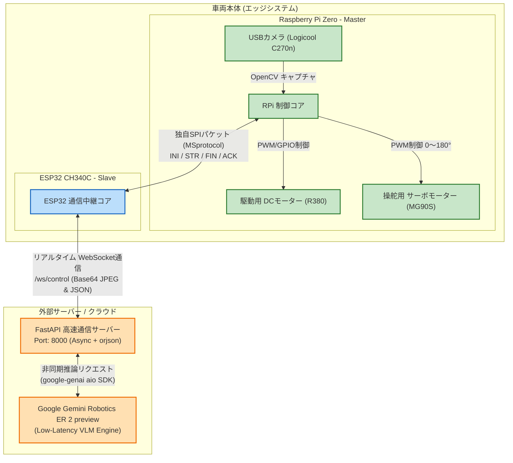
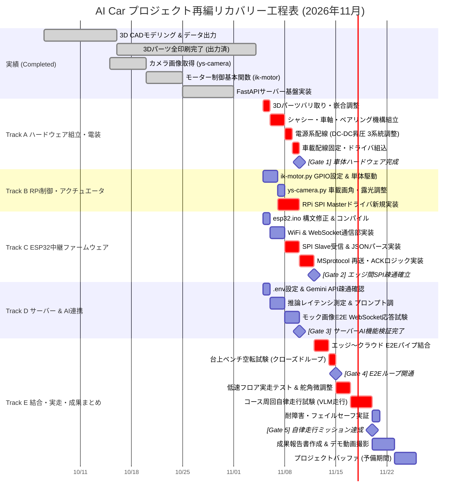
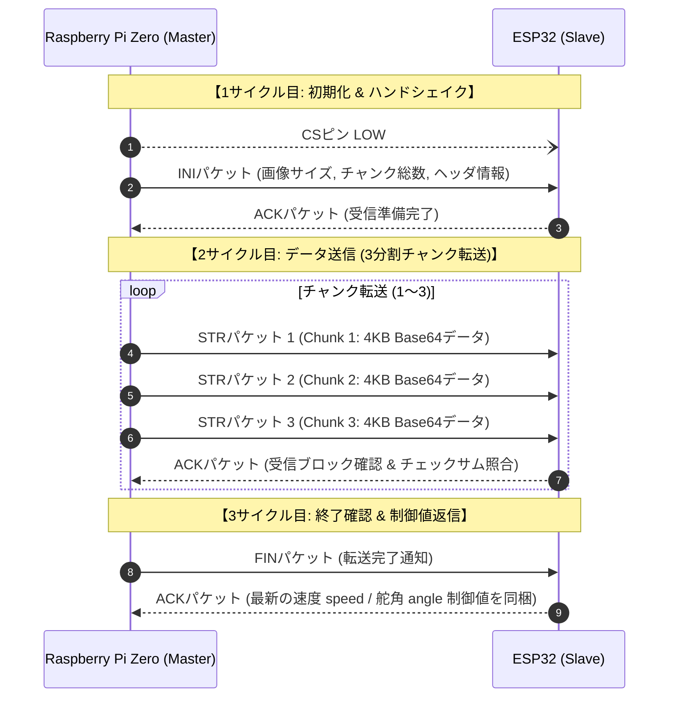

# 🚗 AI Car Autonomous Driving Project (`ai-car`) 総合マスター仕様・プロジェクト再建計画書

> **プロジェクト名:** 画像解析技術および視覚言語モデル (VLM) を用いた自律走行車両の開発  
> **中核技術:** Google Gemini Robotics ER 2 preview + Raspberry Pi Zero (Master / 走行制御・カメラ) + ESP32 CH340C (Slave / SPI受信・WebSocket通信中継) + FastAPI Server  
> **作成・再編日:** 2026年11月5日  
> **プロジェクト状況:** 現状全体に遅延が発生中。ハードウェアは3Dプリント出力のみ完了（未組立・未配線）。本ドキュメントは、プロジェクト管理工学（WBS、クリティカルパス分析、コンカレント開発、フォールバック設計）に基づき、最短かつ無理のないスケジュールで確実に自律走行を達成するための再編マスター統合仕様書である。

---

## 目次
1. [プロジェクト概要・アーキテクチャ (Overview & Architecture)](#1-プロジェクト概要アーキテクチャ-overview--architecture)
2. [現状認識と遅延の真因分析 (Current Status & Root Cause Analysis)](#2-現状認識と遅延の真因分析-current-status--root-cause-analysis)
3. [プロジェクト管理戦略：最短・無理のないリカバリー手法 (Project Management Strategy)](#3-プロジェクト管理戦略最短無理のないリカバリー手法-project-management-strategy)
4. [高解像度スケジュール & ガントチャート (High-Resolution Schedule & Gantt Chart)](#4-高解像度スケジュール--ガントチャート-high-resolution-schedule--gantt-chart)
5. [詳細 WBS & タスクチェックリスト (Detailed WBS & Task Checklist)](#5-詳細-wbs--タスクチェックリスト-detailed-wbs--task-checklist)
6. [ハードウェア仕様・電装・ピンアサイン設計 (Hardware & Electrical Engineering)](#6-ハードウェア仕様電装ピンアサイン設計-hardware--electrical-engineering)
7. [通信プロトコル仕様 & エラーハンドリング (Communication Protocol Specifications)](#7-通信プロトコル仕様--エラーハンドリング-communication-protocol-specifications)
8. [AI / 推論仕様 (Gemini Robotics ER 2 preview)](#8-ai--推論仕様-gemini-robotics-er-2-preview)
9. [制御パラメータ設計 (`ControlConfig`)](#9-制御パラメータ設計-controlconfig)
10. [即時実行アクションプラン (Immediate Action Plan)](#10-即時実行アクションプラン-immediate-action-plan)
11. [リスク管理マトリクス & コンティンジェンシープラン (Risk Management Matrix)](#11-リスク管理マトリクス--コンティンジェンシープラン-risk-management-matrix)
12. [ディレクトリ構成 & 主要ファイルカタログ (Directory & File Catalog)](#12-ディレクトリ構成--主要ファイルカタログ-directory--file-catalog)
13. [申請・調達管理表 (BOM & Procurement)](#13-申請調達管理表-bom--procurement)

---

## 1. プロジェクト概要・アーキテクチャ (Overview & Architecture)

本プロジェクトは、Googleの最新ロボティクス向け視覚言語モデル（VLM: **Gemini Robotics ER 2 preview**）と車載エッジハードウェアを連携させ、車載カメラ映像から周囲の走行可能領域や障害物をリアルタイムに認識・判断し、完全自律走行を行う小型モビリティの開発を目的としています。

### システムアーキテクチャ図 (`README.md` & `data-flowchart.md` 準拠)



### コア動作フロー
1. **画像入力:** Raspberry Pi Zero に接続されたUSBカメラが走行前方映像をキャプチャ（160×120、JPEG品質50に軽量化圧縮）。
2. **SPIパケット転送:** RPi Zero (Master) から ESP32 (Slave) へ、独自プロトコル（3分割STRチャンク転送＋損失再送制御）でSPI高速転送。
3. **クラウド中継:** ESP32 がパケットを再構成し、Wi-Fi経由で外部FastAPIサーバーへ WebSocket (`/ws/control`) 送信。
4. **VLM推論:** FastAPIサーバーが Gemini Robotics ER 2 preview に画像を渡し、思考遅延ゼロ (`thinking_budget=0`) で操舵角（0〜180°）および速度（-255〜255）を推論。
5. **制御フィードバック:** 推論結果が逆ルート（Server → ESP32 WebSocket → RPi SPI）で返信され、RPi ZeroのGPIOがMini-L298NドライバおよびMG90Sサーボを駆動（500ms周期制御）。

---

## 2. 現状認識と遅延の真因分析 (Current Status & Root Cause Analysis)

### 2.1 現状ステータス一覧 (2026年11月5日時点)

| サブシステム | 現在の実績・完了事項 | 未達・残存課題（遅延要因） | 進捗率 |
|---|---|---|:---:|
| **ハードウェア・機構** | 3D CADモデリング完了、**全3Dパーツの印刷完了** (`3d/` 内の全部品) | **組立未着手**。ベアリング圧入、シャフト・プーリー組み付け、ステアリングリンク調整が未実施。 | 40% |
| **電装・電源系** | BOM部品調達完了 (ESP32, L298N, MT3608×3, MG90S, R380) | **配線・半田付け未着手**。MT3608の昇圧調整（5V/7.2V）、ノイズ分離、共通GND配線が未実施。 | 20% |
| **RPi 制御層** | `ys-camera.py` (画像Base64化)、`ik-motor.py` (駆動ロジック骨格) 作成済 | `ik-motor.py` の**GPIOピン番号未決定**。SPI Master通信ドライバ (`raspi_spi_master.py`) 未完成。 | 45% |
| **ESP32 通信層** | 基本SPI Slave初期化の枠組みのみ存在 | `esp32.ino` に**構文エラー・未定義宣言**が残存。WebSocketクライアント未実装。再送処理未完。 | 15% |
| **サーバー / AI** | `server/main.py` (FastAPI + WebSocket + Gemini SDK) 実装済 | `.env` のAPIキー未設定、実機モック疎通・遅延測定未実施。 | 80% |

### 2.2 遅延の真因分析 (Why-Why Analysis & Bottlenecks)

1. **ボトルネック1: エッジ間「独自SPIパケット通信」の実装難易度と検証不足**  
   - RPi ZeroとESP32をSPI接続し、チャンク分割（STR×3）・再送制御を行う独自プロトコル (`MSprotocol.md`) を採用したため、双方向のファームウェア開発が同期的にストップ。ESP32ファームウェアのエラー修正が進まず、通信層全体が停滞していた。
2. **ボトルネック2: ハードウェア組立と電装の「直列作業化」による停滞**  
   - 3Dプリント完了後、機構組立と電装配線が未着手のまま放置され、物理的にモーターやサーボを回すテスト環境（実機ターゲット）が不在のままソフトウェア開発を進めようとしていた。
3. **ボトルネック3: 疎結合テスト環境（モック）の欠如**  
   - サーバー、ESP32、RPiの各モジュールが「全て揃ってから結合する」発想になっており、PC上でのモック画像テストや単体机上テストが行われていなかった。

---

## 3. プロジェクト管理戦略：最短・無理のないリカバリー手法 (Project Management Strategy)

遅延を取り戻し、2.5週間（約15稼働日）で確実に自律走行を成功させるため、以下の4大プロジェクトマネジメント手法を導入します。

### 3.1 コンカレント・エンジニアリング (4並行開発トラックの確立)
全作業を依存関係から解き放ち、以下の4ラインを同時並行（Concurrent）で稼働させます。
- **Track A [HW & Mech]:** シャシー組立、機構調整、電源配線（担当: ハードウェア班）
- **Track B [RPi Master]:** GPIOピン割り当て、モーター単体駆動テスト、SPI Master実装
- **Track C [ESP32 Relay]:** `esp32.ino` 構文修正、WebSocket疎通、SPI Slave受信部実装
- **Track D [Cloud & AI]:** PC環境でのGemini API疎通、推論遅延・プロンプトチューニング

### 3.2 クリティカルパス分析 (CPM) と短縮策
- **プロジェクトのクリティカルパス (最長経路):**  
  `Track A (機構組立・配線)` ➔ `Track B/C (SPI通信確立)` ➔ `Track E (E2Eパイプライン結合)` ➔ `Track E (実走テスト・チューニング)`
- **短縮施策 (Fast-tracking):**
  - 機構組立の完了を待たずに、ブレッドボード上でRPiとESP32、モータードライバの「机上ベンチテスト」をDay 1〜2から先行実施。
  - サーバー検証は実機画像ではなく、PCからダミー画像パケットを投げてDay 1中に完了させる。

### 3.3 段階的検証ゲート (4 Quality Gates)
手戻りを防ぐため、各フェーズ境界に厳密な受入ゲートを設けます。
- **Gate 1 (Day 3): 単体検証ゲート (Unit Readiness)**  
  - モーター/サーボが机上で指令通り回るか？
  - ESP32から外部サーバーにWebSocketでダミーJSONが飛ぶか？
- **Gate 2 (Day 6): エッジ通信確立ゲート (Edge Link Readiness)**  
  - RPiからESP32へSPIで画像データが欠落なく転送できるか？
- **Gate 3 (Day 9): E2Eクローズドループゲート (Full-Loop Readiness)**  
  - 車両のカメラ映像 ➔ サーバー ➔ Gemini推論 ➔ 車輪回転の1往復が500ms以内で完結するか？
- **Gate 4 (Day 15): 自律走行完走ゲート (Autonomous Mission Success)**  
  - コース周回走行（白線維持または障害物回避）を安全停止機能付きで達成できるか？

### 3.4 フォールバック戦略 (納期絶対死守のための迂回ルート)
- **SPI開発難航時のフォールバック (Plan B - Direct Wi-Fi Route):**  
  もし Day 6 時点で RPi ⇔ ESP32 間の独自SPI通信のデバッグが難航した場合、**Raspberry Pi Zero W のオンボード Wi-Fi を有効化し、RPi から直接 FastAPI サーバーへ WebSocket 接続する方式に即日切り替えます**。  
  ※これにより、ESP32のSPIデバッグ停滞による自律走行テスト全体の破綻を100%防止できます（SPI連携は追加成果として後から統合可能）。

---

## 4. 高解像度スケジュール & ガントチャート (High-Resolution Schedule & Gantt Chart)

- **プロジェクト期間:** 2026年11月5日(木) 〜 2026年11月25日(水)  
- **実走ミッション達成目標:** 2026年11月20日(金)（その後予備バッファ5日を確保）



### マイルストーン・検証ゲート一覧

| ゲート | 達成目標日 | 検証内容・合格基準 (Pass Criteria) | クリティカルパス |
|:---:|:---:|---|:---:|
| **Gate 1** | 2026-11-09 | **ハードウェア組立完了:** シャシーにベアリング、車軸、プーリー、モーター、サーボがガタつきなく固定され、電源系（3.7V/7.4V → 5V/7.2V）が正常出力されること。 | ★ Yes |
| **Gate 2** | 2026-11-11 | **エッジ間通信確立:** RPi ZeroからESP32へSPIで画像データが送信され、チェックサムエラーなくJSONが復元されること（失敗時はPlan B直結Wi-Fiへ移行）。 | ★ Yes |
| **Gate 3** | 2026-11-09 | **サーバーAI準備完了:** モック画像に対してGemini Robotics ER 2 previewが0.4秒以内に操舵・速度JSONを返信すること。 | No (並行) |
| **Gate 4** | 2026-11-14 | **E2Eクローズドループ開通:** 車載カメラ ➔ ESP32 ➔ サーバー ➔ モーター駆動が途切れず連続5分間ループ動作すること（車輪空転台上試験）。 | ★ Yes |
| **Gate 5** | 2026-11-20 | **自律走行ミッション達成:** 実フロアにて障害物を回避し、コースを2周以上停止・衝突なしで完走できること。 | ★ Yes |

---

## 5. 詳細 WBS & タスクチェックリスト (Detailed WBS & Task Checklist)

### WP 1.0: ハードウェア機構組立 & 電装配線 (Hardware & Mechanics)
- [x] 1.1 3Dプリンタパーツ全印刷出力（シャシー前後、シャフト、プーリー、タイヤ、治具）
- [ ] 1.2 3Dパーツのバリ取り、ネジ穴タップ立て、ベアリング（計3種）の圧入
- [ ] 1.3 前後輪シャフト、プーリー、駆動ベルト、タイヤの機構アセンブリと回転スムーズ度検査
- [ ] 1.4 MG90S サーボホーン中立位置（90°）出しおよびステアリングタイロッド接続
- [ ] 1.5 MT3608 昇圧コンバータ 3基の電圧校正（①5.0V ロジック用, ②5.0V サーボ用, ③7.2V モーター用）
- [ ] 1.6 バッテリー電源スイッチ、ヒューズ、共通GND配線、パスコン（電解コンデンサ470μF）の実装
- [ ] 1.7 Mini-L298N モータードライバおよび R380 DCモーターの配線とノイズ対策

### WP 2.0: エッジファームウェア & 通信層 (Edge Firmware & Protocol)
- [x] 2.1 RPi側 カメラキャプチャ基本コード作成 (`ys-camera.py`)
- [x] 2.2 RPi側 モーター制御ロジック基本関数作成 (`ik-motor.py`)
- [ ] 2.3 `programs/raspberry-pi-zero/ik-motor.py` の GPIOピン番号定義 (ENA:12, IN1:5, IN2:6, SERVO:13)
- [ ] 2.4 RPi側 SPI Master送信スクリプト (`raspi_spi_master.py`) の新規作成（`spidev` を用いた INI/STR/FIN パケット送出）
- [ ] 2.5 `programs/esp32/esp32.ino` の構文エラー修正 (`SERVER_URL`, `request_resend_spi`, `CHUNKSIZE`)
- [ ] 2.6 ESP32 への Wi-Fi接続機能および `WebSocketsClient` によるサーバー接続実装
- [ ] 2.7 ESP32 側の SPI Slave 受信バッファおよび JSONパケット復元ロジック実装
- [ ] 2.8 `MSprotocol.md` に基づくタイムアウト・再送シーケンス (STR損失時ACK要求) の組み込み

### WP 3.0: サーバー & AI連携エンジン (Server & Cloud VLM)
- [x] 3.1 FastAPI 非同期サーバー基盤実装 (`programs/server/main.py`)
- [x] 3.2 `ControlConfig` 制御パラメータクラスおよび Pydantic スキーマ策定
- [x] 3.3 Gemini Robotics ER 2 preview 呼び出しモジュール策定
- [ ] 3.4 サーバー側 `.env` に `GEMINI_API_KEY` を設定
- [ ] 3.5 テストスクリプトによる Gemini 推論応答速度・トークン消費・判断精度の机上計測
- [ ] 3.6 WebSocket エンドポイント (`/ws/control`) の負荷耐性・切断時自動復旧テスト

### WP 4.0: システム統合 & E2Eクローズドループ試験 (System Integration)
- [ ] 4.1 ブレッドボード机上ベンチテスト（RPi + ESP32 + L298N + サーボでの通信・回転連動確認）
- [ ] 4.2 車載マウントへの全基板・配線・カメラの固定と重量バランス確認
- [ ] 4.3 台上試験（車輪を浮かせた状態でのカメラ画像認識 ➔ モーター加減速 ➔ 操舵応答の連続テスト）
- [ ] 4.4 パケット損失・通信切断時のフェイルセーフ自動停止動作テスト

### WP 5.0: 実走検証・性能評価・報告 (Field Testing & Documentation)
- [ ] 5.1 低速直進テスト（トリム調整、`CAR_STEER_CENTER` の微調整）
- [ ] 5.2 障害物検知・緊急停止距離測定
- [ ] 5.3 テストコース周回自律走行試験（500msサイクルでの追従性能評価）
- [ ] 5.4 走行ログ解析（Gemini推論遅延、SPI転送遅延、制御ジッターの定量化）
- [ ] 5.5 課題研究発表用スライド、デモ走行動画、技術報告書の作成

---

## 6. ハードウェア仕様・電装・ピンアサイン設計 (Hardware & Electrical Engineering)

### 6.1 マイコン・GPIO競合回避ピンアサイン表

Raspberry Pi Zero のハードウェア SPI0 (MOSI=10, MISO=9, SCLK=11, CE0=8) と UART (TXD=14, RXD=15) を保護し、ハードウェアPWM（または高精度タイマー）をモーターとサーボに割り振った競合のない完全なピンアサインです。

| デバイス | 信号名 | RPi Zero (BCMピン) | 物理ピン番号 | 接続先 / 機能詳細 |
|---|---|:---:|:---:|---|
| **SPI0 (Master)** | MOSI | GPIO 10 | Pin 19 | ESP32 GPIO 23 (VSPI MOSI) |
| **SPI0 (Master)** | MISO | GPIO 9 | Pin 21 | ESP32 GPIO 19 (VSPI MISO) |
| **SPI0 (Master)** | SCLK | GPIO 11 | Pin 23 | ESP32 GPIO 18 (VSPI SCLK) |
| **SPI0 (Master)** | CS / CE0 | GPIO 8 | Pin 24 | ESP32 GPIO 5 (VSPI CS) |
| **DCモーター** | PWM (ENA) | **GPIO 12** | Pin 32 | Mini-L298N ENA (PWM0 / 速度制御) |
| **DCモーター** | IN1 | **GPIO 5** | Pin 29 | Mini-L298N IN1 (前進/後進方向制御) |
| **DCモーター** | IN2 | **GPIO 6** | Pin 31 | Mini-L298N IN2 (前進/後進方向制御) |
| **ステアリング** | SERVO_PWM | **GPIO 13** | Pin 33 | MG90S 信号線 (PWM1 / 50Hz舵角制御) |
| **UART (デバッグ)**| TXD | GPIO 14 | Pin 8 | 予備シリアル通信・コンソール用 |
| **UART (デバッグ)**| RXD | GPIO 15 | Pin 10 | 予備シリアル通信・コンソール用 |
| **共通電源** | GND | GND | Pin 6/14/20/39 | システム共通グランド (Common GND) |

### 6.2 電源系統分離アーキテクチャ (3系統 MT3608 昇圧設計)

DCモーターの逆起電力ノイズやサーボ突入電流によるマイコンのリセット（ブラウンアウト）を完全に防止するため、BOM記載の **MT3608 昇圧コンバータ 3基** を以下のように完全独立運用します。

```text
[バッテリー電源 (Li-ion 1S 3.7V または 2S 7.4V)]
   │
   ├── [メインスイッチ & 5Aヒューズ]
   │     │
   │     ├── [MT3608 #1] ──> 5.0V 安定出力 ──> Raspberry Pi Zero & USBカメラ & ESP32 (ロジック系)
   │     │                                       (大容量低ESR電解コンデンサ 470μF 付加)
   │     │
   │     ├── [MT3608 #2] ──> 5.0V 安定出力 ──> MG90S サーボモーター (操舵系)
   │     │                                       (サーボ突入電流をロジックから完全隔離)
   │     │
   │     └── [MT3608 #3] ──> 7.2V 強力出力 ──> Mini-L298N モータードライバ ──> R380 DCモーター (駆動系)
   │                                             (モーターノイズ吸収用 0.1μF パスコン装着)
   │
   └── [共通グランドライン (Common GND)] ─────── 全ユニットのグランド端子を1点接地で結合
```

---

## 7. 通信プロトコル仕様 & エラーハンドリング (Communication Protocol Specifications)

### 7.1 SPI Master-Slave パケット通信 (`MSprotocol.md` 準拠)

Raspberry Pi Zero (**M: Master**) と ESP32 (**S: Slave**) 間の通信シーケンス:



### 7.2 パケット欠落時の自動復旧シーケンス

1. **INI 欠落:** M が 500ms タイムアウトで再送。3回連続失敗でフェイルセーフ発動（車両緊急停止）。
2. **STR チャンク欠落:** S が受信データ長またはチェックサム不一致を検知し、ACK に損失チャンク番号を含めて返信。M は該当チャンクのみをピンポイント再送。
3. **FIN 欠落:** M が 200ms タイムアウトで FIN を再送（最大3回）。
4. **最終 ACK 欠落:** S は ACK 送出後に終了待機。M は 200ms タイムアウト経過で安全に次回サイクルへ移行。

---

## 8. AI / 推論仕様 (Gemini Robotics ER 2 preview)

- **使用モデル:** `gemini-robotics-er-2-preview` (Googleの空間認識・ロボティクス特化最新モデル)
- **SDK:** `google-genai` 公式最新SDK（`client.aio.models.generate_content` による完全非同期処理）
- **高速化設計:**
  - `thinking_budget = 0`, `thinking_level = "low"` によりモデル思考遅延を排除。
  - C言語実装パーサー `orjson` によるナノ秒単位のJSONシリアライズ。
  - 画像は 160×120 / JPEG品質50 に最適化し、ペイロードサイズを約 3〜5 KB に抑制。
- **システム指示 (System Instruction):**
  - 車載前方画像から「進行方向の障害物」「走行可能スペース」を認識。
  - 舵角 `angle` (0:左最大, 90:直進, 180:右最大) と 速度 `speed` (-255〜255, 巡航標準: 180, 停止: 0) を JSON 形式で出力。
- **フェイルセーフ保護機能:**
  - APIキー無効、ネットワーク瞬断、パケット破損検知時は、即座に安全停止パケット (`{"speed": 0, "angle": 90, "status": "failsafe_stop"}`) を返信。

---

## 9. 制御パラメータ設計 (`ControlConfig`)

`programs/server/main.py` および `.env` で一元管理される制御パラメータ群:

| パラメータ名 | 設定値 / デフォルト | 単位 / 範囲 | 挙動説明 |
|---|:---:|:---:|---|
| `CAR_SPEED_MAX` | `255` | -255〜255 | 前進フルスロットル出力 |
| `CAR_SPEED_MIN` | `-255` | -255〜255 | 後進フルスロットル出力 |
| `CAR_SPEED_STOP` | `0` | - | 完全停止 |
| `CAR_SPEED_CRUISE` | `160` | 推奨 120〜180 | 通常自律走行時の安全巡航速度 (初期テストは140推奨) |
| `CAR_STEER_MIN` | `0` | 度 (0〜180) | 左いっぱい転舵 (MG90S) |
| `CAR_STEER_CENTER`| `90` | 度 (0〜180) | 直進中立位置 (走行前トリム要調整) |
| `CAR_STEER_MAX` | `180` | 度 (0〜180) | 右いっぱい転舵 (MG90S) |
| `CAR_DURATION_MS` | `500` | ミリ秒 | 1推論サイクルあたりの駆動持続時間 |

---

## 10. 即時実行アクションプラン (Immediate Action Plan)

### Step 1: `programs/esp32/esp32.ino` のバグ修正
以下の3箇所を即時修正します。
1. **未定義マクロ修正:**
   ```c
   // 修正前:
   #define CHUNKSIZE 4096
   #define SERVER_URL <Input server URL here>
   WORD_ALIGNED_ATTR uint8_t rx_buf[SPI_CHUNKSIZE];
   
   // 修正後:
   #define CHUNKSIZE 4096
   #define SERVER_URL "ws://192.168.1.100:8000/ws/control" // サーバーの実IPアドレス
   WORD_ALIGNED_ATTR uint8_t rx_buf[CHUNKSIZE];
   ```
2. **切れたプロトタイプ宣言の修正:**
   ```c
   // 修正前: void request_resend_spi(const int 

   // 修正後:
   void request_resend_spi(const int chunk_id);
   ```
3. **未定義変数 `doc` の参照バグ修正:**
   ```c
   // 修正前: const int rec_type = doc["header"]["type"] | -1;
   // 修正後:
   const int rec_type = received_doc["header"]["type"] | -1;
   ```

### Step 2: `programs/raspberry-pi-zero/ik-motor.py` のピン設定
```python
# 実機ハードウェアに合わせた確定GPIO割り当て
MOTOR_ENA_PIN = 12   # PWM0 (速度制御)
MOTOR_IN1_PIN = 5    # 方向制御 1
MOTOR_IN2_PIN = 6    # 方向制御 2
SERVO_PIN     = 13   # PWM1 (MG90S 舵角制御)
```

### Step 3: サーバー環境の即時起動と検証
```bash
cd programs/server
python -m venv venv
# Windows:
venv\Scripts\activate
# Linux/macOS:
source venv/bin/activate

pip install -r requirements.txt
cp .env.example .env
# .env に GEMINI_API_KEY を記入
uvicorn main:app --host 0.0.0.0 --port 8000 --reload
```
- ブラウザで `http://localhost:8000/docs` (Swagger UI) を開き、`/api/control` にダミーBase64画像を送信して即時動作を確認可能。

---

## 11. リスク管理マトリクス & コンティンジェンシープラン (Risk Management Matrix)

| リスク事象 | 影響度 | 発生確率 | 予防対策 (Mitigation) | 回避・コンティンジェンシープラン (Contingency) |
|---|:---:|:---:|---|---|
| **SPI通信のデバッグ難航** | 高 | 高 | パケット長を固定長 (4096B) にし、ヘッダ整合性チェックを厳格化。 | **【Plan B 発動】** Day 6 時点で未解決なら、RPi Zero WのWi-Fiを直接有効化しサーバーへ直接WS接続する。 |
| **モーターノイズによるマイコンリセット** | 高 | 中 | MT3608を3基完全分離し、ロジック電源ラインに470μF電解コンデンサを挿入。 | モーター端子に0.1μFセラミックコンデンサを半田付けし高周波ノイズをバイパス。 |
| **Gemini APIの推論遅延増大 (>1.0s)** | 中 | 中 | `thinking_budget=0`、画像解像度160×120/品質50の極小化。 | 1推論あたりの走行持続時間 `DURATION_MS` を動的に延長、または前回操舵角を維持。 |
| **ステアリング機構のガタつき・中立ずれ** | 中 | 高 | 3Dプリントパーツ嵌合部にシムワッシャー挿入、サーボホーン固定ネジをネジロック塗布。 | ソフトウェア側の `CAR_STEER_CENTER` (中立値) を 90° からオフセット調整可能とする。 |
| **追加部材調達の遅延 (申請中BOM)** | 中 | 低 | 代替手持ち部材（手持ちmicroSD、手持ちUSBケーブル）を暫定使用。 | 学校発注が届くまでの間、現行機材（立替分）を継続運用してスケジュールを一切止めない。 |

---

## 12. ディレクトリ構成 & 主要ファイルカタログ (Directory & File Catalog)

```text
ai-car/
├── 3d/                         # FreeCADモデリング & 3Dプリントデータ (全印刷完了済み)
│   ├── シャーシ前.step / シャーシ後ろ.step # メインフレーム (前後分割)
│   ├── 前輪シャフト / 後輪シャフト        # 車軸
│   ├── 前輪プーリー / 後輪プーリー        # タイミングベルト駆動機構
│   ├── 前輪駆動部品 / 前輪駆動部品2       # ナックル・ステアリングリンク
│   ├── ベアリング / ベアリング2 / 部品    # ボールベアリング固定治具
│   ├── 後輪タイヤ                        # 駆動輪
│   ├── サーボモーター固定治具             # MG90S サーボ固定台座
│   └── 締結部品                          # シャシー前後結合ブラケット
├── programs/
│   ├── esp32/
│   │   └── esp32.ino           # ESP32用 SPI Slave ↔ WebSocket 中継ファームウェア
│   ├── raspberry-pi-zero/
│   │   ├── ik-motor.py         # モーター (L298N) & サーボ (MG90S) 駆動制御関数
│   │   ├── ys-camera.py        # USBカメラ画像キャプチャ (160x120 JPEG品質50 Base64)
│   │   ├── main.py             # シリアル通信疎通テストスクリプト
│   │   └── raspi_spi_master.py # 【新規実装予定】SPI Master パケット通信ドライバ
│   └── server/
│       ├── main.py             # FastAPI + Gemini Robotics ER 2 preview 自律走行サーバー
│       ├── requirements.txt    # サーバー依存ライブラリ
│       ├── README.md           # サーバー起動手順書
│       └── .env.example        # 環境変数設定テンプレート
├── receipt/                    # 購入部品領収書 (AliExpress 5点照合済)
├── BOM.csv                     # 購入済み部品表 (5品目 計 ¥2,767)
├── requested-BOM.xlsx          # 申請・追加購入検討機材リスト (計 ¥21,300)
├── MSprotocol.md               # Master-Slave SPI通信プロトコル仕様書 (シーケンス図)
├── data-flowchart.md           # 全体データフロー図 (Mermaid)
├── 中間計画1.md                # 課題研究 中間進捗計画記録
├── 中間計画1_続き.md           # 中間計画 実装方針メモ
└── ai-car-summary.md           # 本ドキュメント (プロジェクト総合マスター仕様書)
```

---

## 13. 申請・調達管理表 (BOM & Procurement)

### 13.1 購入済み部品表 (`BOM.csv`)
AliExpressにて発注・受領済み（ハードウェア実装用）：
1. **ESP32 CH340C Type-C 開発ボード** (¥809)
2. **Mini-L298N デュアルHブリッジ モータードライバ** (¥634)
3. **MT3608 昇圧型 DC-DC コンバータ (3個セット)** (¥449)
4. **MG90S 金属ギア マイクロサーボ 180°** (¥413)
5. **R380 高速DCモーター** (¥462)  
**合計金額:** **¥2,767**

### 13.2 申請中・追加検討部材一覧 (`requested-BOM.xlsx`)
学校予算等による追加調達・立替精算分：
- KIOXIA EXCERIA BASIC 32GB microSD (¥1,859) — RPi Zero OS起動用
- ELECOM MiniHDMI-HDMI変換アダプタ (¥545) & MicroB-A OTGケーブル (¥485) — 初期設定用
- Raspberry Pi Zero W (¥11,241) — 個人立替機材の本機手配
- Logicool C270n Webカメラ (¥1,970) — 個人立替機材の本機手配
- Google Gemini API 利用枠チャージ (¥2,000) — VLM推論実行クレジット
- Bambu PLA ベーシック ジェードホワイト (¥2,200) & Bambu ABS ブラック (¥3,000) — 学校フィラメント補充用  
**申請小計合計:** **¥21,300**

---

*最新更新日: 2026年11月5日*  
*プロジェクト管理責任: ai-car Project Team*