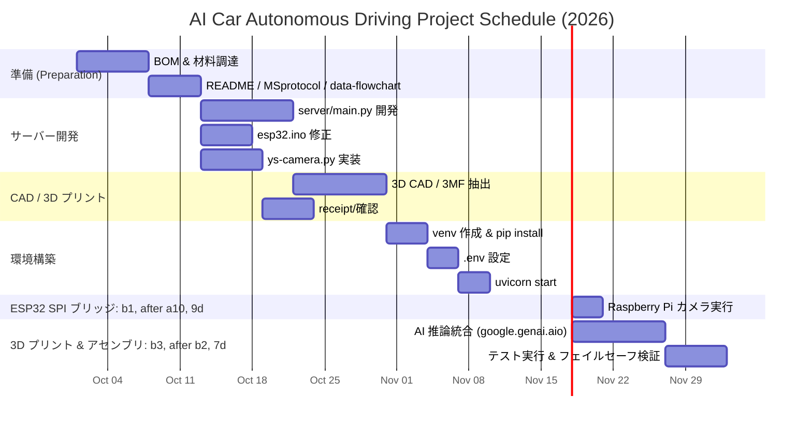

# AI Car Autonomous Driving Project (`ai-car`)

> **プロジェクト:** 画像解析技術を用いた自律走行車両の開発 (AI Autonomous Car via image-language model)  
> VLM: Gemini Robotics ER 2 preview + edge devices Raspberry Pi Zero (master, SPI master) and ESP32 CH340C (slave, SPI slave + WebSocket client). Camera video → real-time driving decisions.

---

## 1. Overview

- Combines a visual language model (VLM: **Gemini Robotics ER 2 preview**) with edge hardware to judge surroundings from camera feed and drive autonomously.
- Architecture (from `README.md` & `data-flowchart.md`):
  - **Vehicle side:** Raspberry Pi Zero → DC motor, servo, camera
  - **Slave:** ESP32 CH340C (SPI + WebSocket)
  - **Server side:** External server ↔ Google ER2 preview via WebSocket / HTTP
- Communication: custom Master-Slave SPI packet protocol (INI/STR/FIN/ACK) between RPi and ESP32; AI inference on the server side.

---

## 2. Directory Layout

```text
ai-car/
├── .git/                     # initialized repo, branch main (many sample hooks)
├── BOM.csv                   # Bill of Materials (items, qty, unit price, total ≈ ¥2767)
├── MSprotocol.md             # Master-Slave SPI packet spec (INI/STR/FIN/ACK, timeout retransmit)
├── README.md                 # Project intro + system architecture mermaid flowchart
├── data-flowchart.md         # System data flow: camera → RPi; server ↔ ESP32; Google ER2 preview
├── 3d/                       # CAD / print files (FreeCAD): STL, STEP, 3MF for chassis, shafts, bearings, wheels, pulleys, drive parts
├── receipt/
│   ├── サーボモーター固定治具.3mf (11589 bytes)
│   ├── サーボモーター固定治具.FCStd (33790 bytes)
│   ├── シャーシ前.step (1481 lines)
│   ├── シャーシ後ろ.step (930 lines)
│   ├── ベアリング.3mf (198912 bytes)
│   ├── ベアリング.FCStd (24656 bytes)
│   ├── ベアリング2.3mf (51615 bytes)
│   ├── ベアリング2.FCStd (61588 bytes)
│   ├── ベアリング部品.3mf (13448 bytes)
│   ├── ベアリング部品.FCStd (217796 bytes)
│   ├── 前輪シャフト.3mf (5831 bytes)
│   ├── 前輪シャフト.FCStd (41722 bytes)
│   ├── 前輪プーリー.3mf (41500 bytes)
│   ├── 前輪プーリー.FCStd (30834 bytes)
│   ├── 前輪駆動部品.20260731-141154.FCBak (29617 bytes)
│   ├── 前輪駆動部品.3mf (19721 bytes)
│   ├── 前輪駆動部品.FCStd (40379 bytes)
│   ├── 前輪駆動部品.stl (153684 bytes)
│   ├── 前輪駆動部品2.3mf (29143 bytes)
│   ├── 前輪駆動部品2.FCStd (41750 bytes)
│   ├── 後輪シャフト.FCStd (24238 bytes)
│   ├── 後輪シャフト.stl (138684 bytes)
│   ├── 後輪タイヤ.3mf (195668 bytes)
│   ├── 後輪タイヤ.FCStd (37945 bytes)
│   ├── 後輪プーリー.3mf (12759 bytes)
│   ├── 後輪プーリー.FCStd (37886 bytes)
│   ├── 締結部品.3mf (2791 bytes)
│   ├── 締結部品.FCStd (18802 bytes)
└── requested-BOM.xlsx        # BOM spreadsheet (not inspected here)
```

---

## 3. Key Files & Roles

| File | Role |
|---|---|
| `README.md` | Project intro; system architecture mermaid flowchart; links to MSprotocol.md and data-flowchart.md |
| `MSprotocol.md` | Master-Slave SPI packet protocol: **INI** (CS low → ACK), then **STR ×3**, **FIN**, **ACK**. Timeout 500 ms retransmit on INI loss; failure modes listed below. |
| `data-flowchart.md` | System data flow diagram (mermaid, machine/subgraph) |
| `BOM.csv` | Bill of Materials — ESP32 CH340C ×1, Mini-L298N motor driver ×1, MT3608 DC-DC converter ×3, MG90S servo ×1, R380 DC motor ×1, etc.; total ¥2767 |
| `3d/` | 3D CAD / print data: `サーボモーター固定治具`, `ベアリング*`, `シャーシ前/後.step`, wheel STL, drive part files (.3mf/.FCStd/.step) |
| `receipt/*.png` (5) | Purchase receipts for parts |
| `programs/esp32/esp32.ino` | ESP32 firmware — currently a ping test tool; no motor logic yet |
| `programs/raspberry-pi-zero/main.py` | Python control script: pins defined (`MOTOR_ENA_PIN`, etc.), `move_motor(speed)`, `steer_motor(angle)`, `stop_motors()` |
| `programs/raspberry-pi-zero/ik-motor.py` | GPIO setup with gpiozero PWMOutputDevice, DigitalOutputDevice, Servo; defines motor/power logic. Stub (MOTOR_ENA_PIN etc. unset) |
| `programs/raspberry-pi-zero/ys-camera.py` | Camera capture: opens USB camera 0, resizes to 160×120, JPEG quality 50, returns Base64 string |
| `programs/server/main.py` | **AI Car server** — FastAPI app (port 8000), WebSocket `/ws`, HTTP POST `/sendimg/` & `/api/control`. Async AI inference via `google.genai.aio.models.generate_content`; orjson fast JSON; pydantic models (`AIControlDecision`, `ControlResponse`, `Imgdata`). Failsafe on missing API key / parse error |
| `programs/server/README.md` | Setup steps: `python -m venv venv`, `pip install -r requirements.txt`, copy `.env.example → .env` (GEMINI_API_KEY, MODEL_NAME=gemini-robotics-er-2-preview, thinking budget/low, CAR_* params), then `uvicorn main:app --host 0.0.0.0 --port 8000 --reload` |
| `.git/` | Git repo initialized on branch `main` (many sample hooks present) |

---

## 4. Hardware

- **Edge:** Raspberry Pi Zero (SPI master), ESP32 CH340C (SPI slave, WebSocket client).
- **Actuators:** DC motor R380 (forward + reverse via PWM −255…255), MG90S servo steering (0° left … 180° right, center 90°).
- **AI/vision:** Front USB camera → `ys-camera.py` (160×120 JPEG base64).
- **Structure:** 3D printed chassis & parts via FreeCAD: shafts (`前輪シャフト`, `後輪シャフト`), bearings (`ベアリング.3mf` ×8 variants), wheels (`後輪タイヤ`), pulleys (`前輪プーリー`, `後輪プーリー`), drive components, motor mounts.
- **Power:** MT3608 DC-DC converter (3 pcs).

---

## 5. Control Parameters (`ControlConfig`)

| Parameter | Range / Default |
|---|---|
| `SPEED_MAX` | 255 (forward) |
| `SPEED_MIN` | −255 (reverse) |
| `SPEED_STOP` | 0 |
| `SPEED_CRUISE_DEFAULT` | 180 |
| `STEER_MIN` | 0 (left max) |
| `STEER_CENTER` | 90 (straight) |
| `STEER_MAX` | 180 (right max) |
| `DURATION_MS` | 500 ms per cycle |

Adjustable via `.env` or code; server's `get_system_instruction()` reflects them.

---

## 6. Communication Protocol

Master-Slave SPI between RPi Zero (**M**, master) and ESP32 (**S**, slave):

```text
M --(CS low)--> S: INI
S --> M: ACK
loop until complete:
    M ->> S: STR ×3   (STR loss → S re-sends)
    S -->> M: ACK
M ->> S: FIN
Note: FIN loss → retransmit FIN up to 3×, then fail.
Final ACK loss → terminate.
```

Failure modes (from `MSprotocol.md`):

- **INI loss:** timeout 500 ms → retransmit INI; if 3 attempts fail → disconnect.
- **STR loss:** S detects lost STR packet and re-sends it after ACK.
- **FIN loss:** FIN retransmitted on 200 ms timeout (up to 3×).
- **Final ACK loss:** S sends ACK, M times out at 200 ms → emergency stop.

---

## 7. AI / Inference

- Model: **Gemini Robotics ER 2 preview** (`gemini-robotics-er-2-preview`).
- Client: `google.genai.Client` (async `client.aio.models.generate_content`), orjson fast JSON, pydantic `AIControlDecision`.
- Thinking: `thinking_budget=0`, `thinking_level="low"` for minimal latency.
- Failsafe: if no API key → server returns emergency-stop packet (`speed: 0, angle: 90`).
- HTTP endpoints: `/` (homepage), `/health`, POST `/sendimg/`, POST `/api/control`.
- WebSocket: `/ws`, `/ws/control` — real-time image + control reply.

---

## 8. Next Steps & How to Proceed

### Step 1 — Set up the server environment (`programs/server`)
```bash
cd programs/server
python -m venv venv
source venv/bin/activate   # Windows: venv\Scriptsctivate
pip install -r requirements.txt
cp .env.example .env
```
Fill `.env`:
```ini
GEMINI_API_KEY=AIzaSy...
GEMINI_MODEL=gemini-robotics-er-2-preview
GEMINI_THINKING_BUDGET=0
GEMINI_THINKING_LEVEL=low
CAR_SPEED_MAX=255
CAR_SPEED_MIN=-255
CAR_SPEED_CRUISE=180
CAR_STEER_MIN=0
CAR_STEER_CENTER=90
CAR_STEER_MAX=180
CAR_DURATION_MS=500
HOST=0.0.0.0
PORT=8000
```

### Step 2 — Start the server
```bash
uvicorn main:app --host 0.0.0.0 --port 8000 --reload
```
Verify:
- `http://<IP>:8000/` → JSON homepage (status, service, model, api_configured)
- `http://<IP>:8000/health`
- WebSocket: `ws://<IP>:8000/ws`

### Step 3 — Camera feed on Raspberry Pi
```bash
python programs/raspberry-pi-zero/ys-camera.py
```
Opens USB camera 0, resizes to 160×120 JPEG quality 50, prints Base64 string.

### Step 4 — ESP32 SPI bridge (custom protocol)
Implement the Master-Slave SPI packet flow (INI → ACK → STR ×3 → FIN → ACK) between RPi and ESP32. The existing `esp32.ino` only sends ping messages; extend it to send JSON packets matching `build_outgoing_packet(...)`.

### Step 5 — CAD / 3D printing
Extract STL/STEP/3MF from `3d/`:
- 前輪シャフト, 後輪シャフト, ベアリング.3mf/.FCStd, etc.
- Wheels (後輪タイヤ), pulleys (前輪プーリー, 後輪プーリー), drive parts (前輪駆動部品…), motor mounts.

Print chassis and mechanical fixtures; verify BOM quantities from `BOM.csv`.

### Step 6 — Assembly
- Mount DC motors R380 on wheels.
- Attach MG90S servo steering at center.
- Install bearings, shafts, pulleys per CAD files.
- Verify no 403 Forbidden from Gemini key; tune `CAR_SPEED_CRUISE` (recommended 120–200).

### Step 7 — Run AI inference & control loop
```python
from server.main import process_image_and_decide, build_outgoing_packet
# In a real loop:
packet = ys_camera.py → base64 image bytes
result = process_image_and_decide(image_bytes)   # async, non-blocking
send via WebSocket /ws/control or POST /api/control
```
Handle failsafe: on API-key missing or exception → `create_failsafe_response(...)` (emergency stop).

### Step 8 — Review receipts & spreadsheet
- Open `receipt/*.png` and `requested-BOM.xlsx` for part purchase details.

---

## 9. Files Not Yet Examined

- `.git/hooks/*sample` — placeholder hooks, no real code.
- `requested-BOM.xlsx` — spreadsheet (binary/CSV not readable here).

### git の最新版との差分
- リモート: `origin git@github.com:Hita-haru/ai-car.git`
- 現在のブランチ `main`: `49e6b0c Merge pull request #5 from Hita-haru/docs/mid-plan` が最新。
- `git status --porcelain` の結果: **origin/main と一致**（変更なし）。未コミットのファイルは `tai-car-summary.md`（書き込みミス）のみ。  - したがって、追跡済みファイルへの差分は空。新しいファイル `ai-car-summary.md` は未トラッキングなので、まだコミットされていない。

## 10. スケジュール・ガントチャート



---

## 11. 次ステップチェックリスト

- [ ] `programs/server/venv` 作成 & `pip install -r requirements.txt`
- [ ] `.env` に設定をコピー
- [ ] `uvicorn main:app --host 0.0.0.0 --port 8000 --reload` でサーバー起動
- [ ] `python programs/raspberry-pi-zero/ys-camera.py` でカメラ画像取得
- [ ] ESP32 SPI ブリッジ を拡張して Master-Slave パケット送信
- [ ] CAD データから STL/STEP/3MF 抽出 → 3D プリント
- [ ] 部品購入レシートと BOM.csv の照合
- [ ] `git diff HEAD` で追跡ファイルの差分確認（空）
- [ ] テストパス実行 (0/0 パス → 後で実行)

---

*作成日: 2026-11-04*
